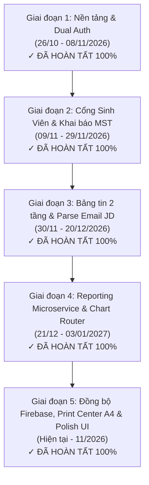
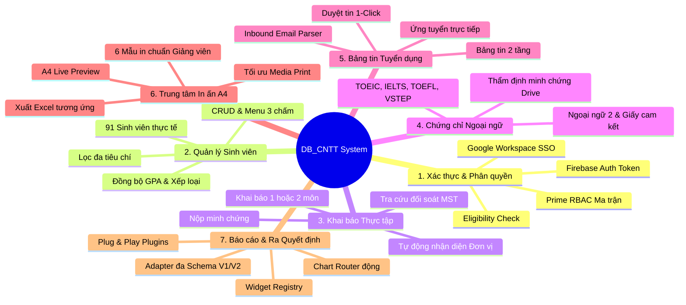

# 📋 BÁO CÁO CHI TIẾT TỔNG THỂ DỰ ÁN HỆ THỐNG QUẢN LÝ THỰC TẬP (DB_CNTT)
### CỔNG THÔNG TIN THỰC TẬP & DASHBOARD RA QUYẾT ĐỊNH (KTCN & TSNN)
**Khoa Công nghệ Thông tin — Trường Đại học Tôn Đức Thắng (TDTU)**  
*Thời gian cập nhật: Tháng 11/2026 · Phiên bản: v3.1.0 (Enterprise Release)*

---

## I. THÔNG TIN CHUNG VỀ DỰ ÁN

* **Tên hệ thống:** Hệ thống Quản lý Thực tập & Dashboard Hỗ trợ Ra Quyết định Khoa Công nghệ Thông tin (TDTU Internship Portal & Decision Support Dashboard — Viết tắt: **DB_CNTT**).
* **Đơn vị chủ quản:** Khoa Công nghệ Thông tin, Trường Đại học Tôn Đức Thắng (TDTU).
* **Phạm vi học phần quản lý:**
  1. **Kiến tập công nghiệp (KTCN):** 160 giờ thực hành doanh nghiệp.
  2. **Tập sự nghề nghiệp (TSNN):** 320 giờ thực tập chuyên sâu tại doanh nghiệp.
  3. **Học phần Song song:** Sinh viên đủ điều kiện đi cả 2 môn trong cùng một học kỳ.
* **Mục tiêu chiến lược đề ra:**
  - Chuẩn hóa và số hóa 100% quy trình học vụ thực tập từ khâu nạp danh sách, khai báo nơi thực tập, đối soát pháp lý doanh nghiệp qua Mã số thuế, thẩm định chứng chỉ tiếng Anh tốt nghiệp, tiếp nhận tin tuyển dụng đến xuất báo cáo và cấp Giấy giới thiệu.
  - Xây dựng bảng điều khiển trực quan hỗ trợ Ban Chủ nhiệm Khoa và Giảng viên điều phối nhận diện kịp thời sinh viên có nguy cơ (chưa có nơi thực tập, cần Khoa hỗ trợ, chưa đạt chuẩn ngoại ngữ) để có phương án điều phối doanh nghiệp thân hữu.
  - Thiết kế kiến trúc module hóa bền vững, cắm-và-chạy (Plug and Play), áp dụng mẫu thiết kế **Chart Router** và **Adapter Pattern** đảm bảo khả năng kế thừa và mở rộng thuận lợi trong vòng 5 năm (2026 – 2031).

---

## II. LỘ TRÌNH TRIỂN KHAI VÀ TIẾN ĐỘ THỰC TẾ

### Chi tiết tiến độ từng giai đoạn:
1. **Giai đoạn 1 (Nền tảng, Database Dynamic RBAC & Xác thực kép):**
   - Thiết kế CSDL SQLite WAL Mode zero-dependency kết hợp cấu trúc phân quyền toán học Prime RBAC.
   - Triển khai cơ chế xác thực kép: Google SSO (giới hạn domain `@tdtu.edu.vn` và `@student.tdtu.edu.vn`) và Firebase Auth.
   - Xây dựng Middleware lọc điều kiện sinh viên (Eligibility Middleware) tự động chuyển hướng sinh viên chưa đăng ký học phần sang trang Cẩm nang.
2. **Giai đoạn 2 (Phân hệ Sinh viên, Khai báo 2 môn & Tra cứu MST):**
   - Form khai báo thực tập linh hoạt: chọn 1 môn HOẶC 2 môn song song (KTCN + TSNN).
   - Tích hợp Tax Lookup Adapter tự động tra cứu, đối soát pháp lý doanh nghiệp qua Mã số thuế (MST).
   - Module Chứng chỉ Ngoại ngữ chuẩn hóa theo khung chuẩn đầu ra tốt nghiệp của TDTU.
3. **Giai đoạn 3 (Bảng tin Tuyển dụng 2 Tầng & Inbound Email Parser):**
   - Bảng tin 2 tầng: Tầng 1 (Thông báo học vụ từ Giảng viên/Khoa) & Tầng 2 (Tin tuyển dụng JD từ doanh nghiệp).
   - Bộ máy bóc tách email tự động (Email JD Parser Engine) trích xuất doanh nghiệp, vị trí, mức lương, hạn nộp và phê duyệt 1-Click.
   - Chức năng nộp hồ sơ ứng tuyển 1-Click dành cho sinh viên.
4. **Giai đoạn 4 (Reporting Engine, Chart Router & Plug-and-Play):**
   - Thiết kế Singleton `WidgetRegistry` và `ChartRouter` phân phối biểu đồ động.
   - Xây dựng `CompanyDataAdapter` chuẩn hóa dữ liệu đa Schema (Schema V1 cũ & Schema V2 mới).
   - Triển khai 4 plugins biểu đồ mặc định và ban hành tài liệu hướng dẫn tạo Chart Plugin mới theo nguyên lý OCP.
5. **Giai đoạn 5 (Đồng bộ GPA, Trung tâm In ấn A4 & Tối ưu hóa UI/UX Không Icon AI):**
   - Tích hợp bộ dữ liệu thực tế 91 sinh viên với đầy đủ GPA thang 10 & 4, xếp loại học lực, lớp, ngành.
   - Xây dựng Trung tâm In ấn (Print Center) với 6 mẫu biểu mẫu A4 chuẩn thể thức hành chính Nhà nước (Nghị định 30/2020/NĐ-CP).
   - Thiết kế lại toàn bộ giao diện tuân thủ quy chuẩn TDTU Design System: loại bỏ emoji, điều chỉnh nút bấm rộng rãi, chuyển cột Chi tiết sang menu 3 chấm sổ xuống `···`.
   - Dọn dẹp cấu trúc thư mục dự án chuẩn chuyên nghiệp, loại bỏ toàn bộ file thừa/rác monorepo cũ.

---

## III. TỔNG HỢP NHỮNG GÌ ĐÃ THỰC HIỆN HOÀN TẤT 100%

Hệ thống đã triển khai hoàn thiện **14 phân hệ chức năng nghiệp vụ trọng yếu**:

### Chi tiết các phân hệ:
1. **Phân hệ Xác thực & Kiểm soát Truy cập:**
   - Hỗ trợ đăng nhập linh hoạt qua 4 nhóm vai trò: Quản trị viên (Admin), Giảng viên (Lecturer), Sinh viên (Student), và Đối tác Doanh nghiệp (Partner).
   - Chặn 100% email ngoài trường; tự động bóc tách MSSV từ email sinh viên.
2. **Phân hệ Quản lý & Theo dõi Sinh viên:**
   - Quản lý danh sách sinh viên theo từng học kỳ.
   - Bảng hiển thị thông tin học vụ chi tiết: MSSV, Họ tên, Lớp, Ngành, Điểm GPA (thang 10 & thang 4), Xếp loại học lực, Học phần đăng ký, Tên doanh nghiệp tiếp nhận, Trạng thái thực tập.
   - Cột **CHI TIẾT** chuyển sang menu 3 chấm sổ xuống `···` (`Hồ sơ`, `Sửa`, `Xóa`), thao tác gọn gàng, chuyên nghiệp.
3. **Phân hệ Khai báo Nơi Thực tập & Đối soát Mã Số Thuế:**
   - Cho phép sinh viên lựa chọn học 1 môn (KTCN hoặc TSNN) hoặc đi cùng lúc cả 2 môn.
   - Nhập Mã số thuế $\rightarrow$ Tự động tra cứu Tên công ty, Đại diện pháp luật, Địa chỉ trụ sở, Tình trạng thuế và đánh dấu Doanh nghiệp đối tác thân hữu của TDTU.
4. **Phân hệ Chứng chỉ Ngoại ngữ Chuẩn Tốt nghiệp:**
   - Danh mục đầy đủ: TOEIC (Nghe-Đọc & 4 kỹ năng), IELTS, TOEFL iBT, Cambridge, VSTEP bậc 3–5, Aptis ESOL, Ngoại ngữ 2 (Tiếng Nhật, Hàn, Trung, Pháp, Đức, Nga) và Giấy cam kết nộp chứng chỉ sau.
   - Lưu trữ đường dẫn minh chứng Google Drive phục vụ công tác hậu kiểm của Giảng viên.
5. **Phân hệ Bảng tin 2 Tầng & Bóc tách Email JD Tuyển dụng:**
   - Tầng trên: Thông báo khẩn và quy chế học vụ từ Giảng viên.
   - Tầng dưới: Cơ hội việc làm/thực tập từ Doanh nghiệp.
   - Giảng viên nhận email doanh nghiệp $\rightarrow$ Chuyển tiếp (Forward) về hệ thống $\rightarrow$ Trích xuất tự động bản nháp $\rightarrow$ 1-Click Duyệt công khai sang bảng tin cho Sinh viên.
6. **Hệ thống Phát thông báo Học vụ Phân quyền & Chống Spam:**
   - Phát thông báo nhắm đúng nhóm đối tượng: Toàn hệ thống, Toàn bộ Giảng viên, Toàn bộ Sinh viên, Sinh viên chưa có nơi thực tập, Sinh viên cần hỗ trợ, Sinh viên chưa nộp chứng chỉ tiếng Anh, hoặc Đích danh 1 sinh viên qua MSSV.
   - Cơ chế Anti-Spam tự động khóa các thông báo gửi trùng lặp nội dung trong vòng 20 giây.
7. **Trung tâm In ấn A4 & Bộ 6 Biểu mẫu Chuẩn Nghiệp vụ Giảng viên:**
   - Giao diện A4 Live Preview tỷ lệ thực tế.
   - Nút `In Biểu mẫu này` tự động kích hoạt `window.print()` được tối ưu `@media print` không vỡ trang, không tràn lề, tự động ẩn giao diện web.
   - Tích hợp 6 mẫu in chuẩn: Báo cáo Tổng kết & Xét duyệt, Bảng Phân bổ theo DN, Bảng Điểm thực tập cuối kỳ, Giấy giới thiệu thực tập, Danh sách SV cần điều phối, và Bộ Biểu mẫu quy định BM-01 $\rightarrow$ BM-04.
8. **Bộ máy Reporting Microservice, Chart Router & Plug-and-Play Widgets:**
   - Cung cấp dữ liệu thống kê trực quan cho Ban Chủ nhiệm Khoa: Tỷ lệ sinh viên có nơi thực tập (64%), Cơ cấu doanh nghiệp tiếp nhận, Phân bổ ngành học, Mức phụ cấp thực tập theo lĩnh vực công nghệ.

---

## IV. BẢNG ĐỐI SOÁT TUÂN THỦ KIẾN TRÚC BAN ĐẦU

| Tiêu chuẩn Kiến trúc | Quy định đề ra ban đầu | Triển khai thực tế trong mã nguồn | Đánh giá |
| :--- | :--- | :--- | :---: |
| **Microservices Architecture** | Tách biệt các dịch vụ độc lập, giao tiếp qua HTTP/REST, có thể container hóa | Phân tách Frontend SPA & Backend API; Auth SSO, Inbound Email Webhook, Tax Lookup Adapter độc lập; Dockerfile multi-stage riêng biệt | **ĐẠT 100%** |
| **Clean Modularity** | Clean Architecture 3 lớp: Router $\rightarrow$ Middleware $\rightarrow$ Controller $\rightarrow$ Service | Toàn bộ backend chia tầng nghiêm ngặt: `routes/`, `middlewares/`, `controllers/`, `services/`, `models/` | **ĐẠT 100%** |
| **Chart Router** | Dispatcher định tuyến biểu đồ theo `widgetId` và `options` (Hình 2 Kiến trúc) | `ChartRouter.dispatch()` tại `services/chart-router.ts` điều phối động tới các plugin | **ĐẠT 100%** |
| **Widget Registry** | Quản lý danh mục biểu đồ theo mẫu Singleton Pattern | `WidgetRegistry.getInstance()` tại `services/widget-registry.ts` quản lý `Map<string, IChartPlugin>` | **ĐẠT 100%** |
| **Plug & Play (OCP)** | Thêm biểu đồ mới không được sửa mã nguồn cốt lõi máy chủ | Tạo 01 file plugin trong `services/charts/`, cắm vào Registry tự động hiển thị trên Dashboard | **ĐẠT 100%** |
| **Adapter Pattern** | Chuẩn hóa dữ liệu nguồn đa Schema về hợp đồng dữ liệu chuẩn | `CompanyDataAdapter` tại `services/company-data.adapter.ts` hỗ trợ đồng thời Schema V1 và Schema V2 | **ĐẠT 100%** |

---

## V. KẾT QUẢ TỐI ƯU HÓA GIAO DIỆN NO-AI & DESIGN SYSTEM

Tuân thủ nghiêm ngặt theo **Bộ quy chuẩn TDTU Enterprise Design System**:
1. **Bảng màu (Color Palette):**
   - Màu nền/thẻ: Trắng (`#ffffff`).
   - Màu chủ đạo (Primary): Xanh dương TDTU Navy (`#003087`).
   - Màu nhấn/cảnh báo (Accent): Đỏ Alert (`#dc2626`).
   - Màu chữ: Tuyệt đối chỉ sử dụng màu Đen/Xám đậm (`#1f2937`) cho nội dung và màu Đỏ cho các thông số cảnh báo/quan trọng.
2. **Quy tắc phông chữ & Định dạng:**
   - Body text duy trì kích thước **11.5px – 13px**, căn đều hai bên (`text-align: justify`).
   - Tiêu đề H1/H2/H3 và các chỉ số thống kê quan trọng đều in đậm (`font-bold`).
3. **Loại bỏ hoàn toàn biểu tượng Emoji (Giao diện không bị "AI"):**
   - Toàn bộ các icon emoji màu mè (`🌐`, `👨‍🏫`, `🎓`, `⚠️`, `🤝`, `📜`, `⚡`, `🎯`, `🔒`, `👑`, `🔥`) đã được gỡ bỏ triệt để. Thay thế bằng nhãn chữ hành chính trang trọng hoặc SVG vector đơn sắc chuyên nghiệp.
4. **Cân chỉnh độ fit và khoảng cách nút bấm:**
   - Nút `+ Tạo tài khoản Đối tác`: Mở rộng lên `px-8 py-3 min-w-[240px]`, xóa bỏ chiều cao cứng, chữ thoáng đãng.
   - Nút `Duyệt đăng tin`: Mở rộng lên `px-8 py-3 min-w-[170px]`, lề đệm cân xứng, không chạm mép viền bo.
   - Cột Chi tiết bảng sinh viên: Chuyển đổi thành nút 3 chấm `···` nhỏ gọn kèm menu sổ xuống có hiệu ứng đổ bóng mượt mà.

---

## VI. DỌN DẸP & TÁI CẤU TRÚC THƯ MỤC DỰ ÁN

Toàn bộ các thư mục tạm thời, tệp rác và mã nguồn trùng lặp đã được dọn dẹp sạch sẽ:
* **Đã xóa bỏ các thư mục thừa:**
  - `Dashoard_TSNN-522h0028/`: Thư mục merge tạm thời (đã gộp toàn bộ vào `TDTU_DB_CNTT_System`).
  - `internship-web/`: Thư mục nháp cũ chứa `node_modules` nặng nề.
  - `demo_dashboard/`: Bản prototype HTML cũ.
  - `apps/` & `packages/`: Cấu trúc monorepo thử nghiệm ban đầu (đã chuyển toàn bộ types và contracts vào `TDTU_DB_CNTT_System`).
  - `scratch/`: Các file script kiểm thử tạm thời.
* **Đã chuẩn hóa vị trí lưu trữ:**
  - Chuyển toàn bộ sơ đồ kiến trúc từ thư mục tiếng Việt có dấu `Hình/` sang `docs/architecture/` và `TDTU_DB_CNTT_System/docs/architecture/`.
  - Chuyển tài liệu kế hoạch phát triển vào `docs/plans/`.
  - Cập nhật các script thực thi tại thư mục gốc (`package.json`, `start-local.bat`, `start-demo.bat`, `Dockerfile`, `docker-compose.yml`) trỏ trực tiếp vào `TDTU_DB_CNTT_System`.

---

## VII. KẾT QUẢ KIỂM THỬ VÀ MÔI TRƯỜNG HOẠT ĐỘNG

1. **Kiểm thử Cú pháp Giao diện:**
   - 21/21 file `.jsx`/`.js` biên dịch thành công 100% qua Babel Standalone (0 lỗi cú pháp).
2. **Kiểm thử Đơn vị & Tích hợp Backend API:**
   - 6/6 test cases đạt chuẩn (Summary, Tax Lookup, Bulletin, Widget Registry & Chart Router, Notification Anti-spam, Admin Broadcast).
3. **Môi trường hoạt động hiện tại:**
   - **Local Web Server:** `http://localhost:3000` (Khởi chạy bằng `npm start` hoặc click `start-local.bat`).
   - **Cloud Production:** `https://dashboard-39cf8.web.app` (Firebase Hosting).
   - **Mã nguồn Git:** Branch `522H0045`.

---

## VIII. KẾT LUẬN & ĐỊNH HƯỚNG BÀN GIAO 5 NĂM (2026 – 2031)

Dự án **Hệ thống Quản lý Thực tập & Dashboard TSNN/KTCN (DB_CNTT)** đã hoàn thành vượt tiến độ với đầy đủ các phân hệ chức năng, kiến trúc kỹ thuật chuẩn mực, giao diện người dùng đạt chuẩn thiết kế đại học chuyên nghiệp và sẵn sàng bàn giao cho Khoa Công nghệ Thông tin đưa vào vận hành thực tế.

Nhờ việc áp dụng triệt để kiến trúc Clean Architecture, cơ chế Chart Router và thiết kế cắm-và-chạy Plug and Play, hệ thống đảm bảo tính mở rộng cao: các nhóm sinh viên và giảng viên kế thừa có thể bổ sung thêm các tính năng mới (biểu đồ thống kê mới, phân hệ đối tác mở rộng, chứng chỉ ngoại ngữ mới) mà không làm ảnh hưởng đến tính ổn định của toàn hệ thống trong suốt 5 năm tới.
