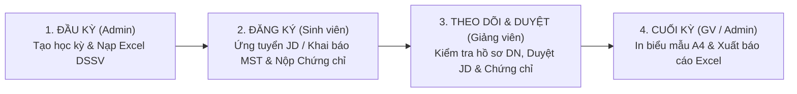

# HƯỚNG DẪN SỬ DỤNG NHANH — HỆ THỐNG QUẢN LÝ THỰC TẬP KHOA CNTT (TDTU)

- **Link Web trực tuyến:** [https://dashboard-39cf8.web.app](https://dashboard-39cf8.web.app)
- **Phiên bản:** `v3.2.0 (Build v125)` — Khoa Công nghệ Thông tin, Trường Đại học Tôn Đức Thắng

---

## 1. TÀI KHOẢN ĐĂNG NHẬP KIỂM THỬ
*(Chọn đúng tab **Giảng viên / Nội bộ** hoặc **Sinh viên** tại màn hình đăng nhập, sau đó nhập Email & Mật khẩu)*

| Vai trò | Tab đăng nhập | Email đăng nhập | Mật khẩu | Quyền hạn chính |
| :--- | :--- | :--- | :--- | :--- |
| **Admin (Toàn quyền)** | `Giảng viên / Nội bộ` | `duonghuuphuc@tdtu.edu.vn` | `Admin@123456` | Tạo học kỳ, nạp Excel, phân quyền, duyệt hồ sơ |
| **Giảng viên** | `Giảng viên / Nội bộ` | `nguyenvana@tdtu.edu.vn` | `Gv@123456` | Xem thống kê, theo dõi SV, duyệt chứng chỉ, đăng tin |
| **Sinh viên Trong kỳ** | `Sinh viên` | `522h0045@student.tdtu.edu.vn` | `Sv@123456` | Khai báo thực tập, nộp chứng chỉ, ứng tuyển JD |
| **Sinh viên Ngoài kỳ** | `Sinh viên` | `52100999@student.tdtu.edu.vn` | `Sv@123456` | Chỉ xem Tổng quan & Bảng tin (khóa khai báo) |

---

## 2. LUỒNG SỬ DỤNG TỔNG THỂ (USAGE FLOW)

**Tóm tắt luồng tương tác 2 chiều (Đồng bộ tức thì):**
1. **Luồng Mở kỳ (`Admin → Hệ thống`):** Admin tạo/chọn học kỳ active và nạp file Excel danh sách sinh viên. Hệ thống tự động cấp quyền **SV Trong kỳ** cho những MSSV có trong danh sách (SV bị xóa hoặc không có tên sẽ tự động chuyển về **SV Ngoài kỳ**).
2. **Luồng Tuyển dụng (`Doanh nghiệp / Khoa → Sinh viên`):** Giảng viên đăng thông báo hoặc duyệt Email JD lên **Bảng tin** → Sinh viên xem thông báo, chọn CV và nhấn **Ứng tuyển** → Giảng viên bấm **`[✓ Tiếp nhận]`** → Hệ thống tự chuyển trạng thái SV sang **"Đã có nơi TT"**.
3. **Luồng Tự khai báo (`Sinh viên → Giảng viên`):** Sinh viên đã tự tìm được công ty vào mục **Khai báo thực tập**, nhập **Mã số thuế (MST)** để tự động điền thông tin công ty và gửi phiếu → Hồ sơ doanh nghiệp & Mentor đồng bộ ngay sang bảng **Danh sách sinh viên** của Giảng viên.
4. **Luồng Chứng chỉ & Tổng kết (`Sinh viên → Giảng viên → Báo cáo`):** Sinh viên nộp chứng chỉ tiếng Anh → Giảng viên duyệt **Đạt / Từ chối** → Cuối kỳ Giảng viên/Admin in 6 biểu mẫu A4 hoặc xuất file Excel tổng hợp.

---

## 3. CHỨC NĂNG QUAN TRỌNG THEO VAI TRÒ

### A. Giảng viên & Quản trị viên (Admin)
- **Tổng quan (`/dashboard`):** Xem KPI theo học kỳ (Tổng SV, Đã có nơi TT, Đang tìm, Cần hỗ trợ) và biểu đồ phân tích.
- **Quản lý học kỳ & Nhập Excel (`/semesters`, `/import` — Admin):** Tạo học kỳ, đặt hạn chót và tải file Excel (`.xlsx`) danh sách SV (chế độ *Thay thế toàn bộ* hoặc *Bổ sung*).
- **Danh sách sinh viên (`/students`):** Lọc SV theo học kỳ/ngành/trạng thái; xem hồ sơ chi tiết 4 tab (*Cá nhân*, *Doanh nghiệp*, *Chứng chỉ*, *Lịch sử*), thêm/xóa SV.
- **Chứng chỉ ngoại ngữ (`/certificates`):** Thẩm định chứng chỉ tiếng Anh của sinh viên (`Đạt` / `Từ chối`).
- **Bảng tin & Duyệt Email JD (`/bulletin`, `/email-jd`):** Đăng thông báo học vụ, tách tự động email doanh nghiệp thành JD 1-Click, duyệt đơn ứng tuyển của SV.
- **Biểu mẫu A4 & Xuất Excel (`/documents`, `/export`):** In 6 biểu mẫu hành chính chuẩn A4 và xuất báo cáo Excel theo kỳ.
- **Tài khoản & Phân quyền (`/accounts` — Admin):** Quản lý người dùng và bật/tắt quyền truy cập từng phân hệ.

### B. Sinh viên
- **Khai báo thực tập (`/declarations`):** Đăng ký 1 môn (Kiến tập 160h / Tập sự 320h) hoặc cả 2 môn; nhập **MST** (VD: `0101248141`) để tự điền thông tin công ty, vị trí & Mentor. *(Dữ liệu khai báo được cô lập riêng theo từng học kỳ).*
- **Chứng chỉ ngoại ngữ (`/certificates`):** Nộp điểm & link minh chứng tiếng Anh (nộp mới tự động ghi đè bản cũ).
- **Bảng tin JD & Hồ sơ (`/bulletin`, `/profile`):** Xem thông báo, nộp CV ứng tuyển thực tập và cập nhật thông tin cá nhân.

---

## 4. HƯỚNG DẪN THAO TÁC KIỂM THỬ TỪNG BƯỚC

1. **Bước 1 — Nạp danh sách đầu kỳ (Admin):** Đăng nhập `duonghuuphuc@tdtu.edu.vn` → Vào **Quản lý học kỳ** kiểm tra kỳ active (`HK1 2026–2027`) → Vào **Nhập file Excel SV** tải file Excel danh sách SV lên → Mở **Danh sách sinh viên** kiểm tra.
2. **Bước 2 — Khai báo & Nộp chứng chỉ (Sinh viên):** Đăng nhập `522h0045@student.tdtu.edu.vn` → Vào **Khai báo thực tập**, nhập MST `0101248141`, điền Mentor và bấm **Gửi khai báo** → Vào **Chứng chỉ ngoại ngữ** nộp chứng chỉ.
3. **Bước 3 — Kiểm tra đồng bộ & Duyệt hồ sơ (Giảng viên):** Đăng nhập `nguyenvana@tdtu.edu.vn` → Vào **Danh sách sinh viên**, bấm vào SV `522H0045` xem tab *Doanh nghiệp* đã cập nhật tức thì → Vào **Chứng chỉ ngoại ngữ** duyệt chứng chỉ.
4. **Bước 4 — In ấn & Xuất báo cáo (Giảng viên / Admin):** Vào **Tài liệu & Biểu mẫu** → Chọn mẫu văn bản để **In A4** hoặc bấm **Xuất Excel** để tải báo cáo tổng hợp học kỳ.
