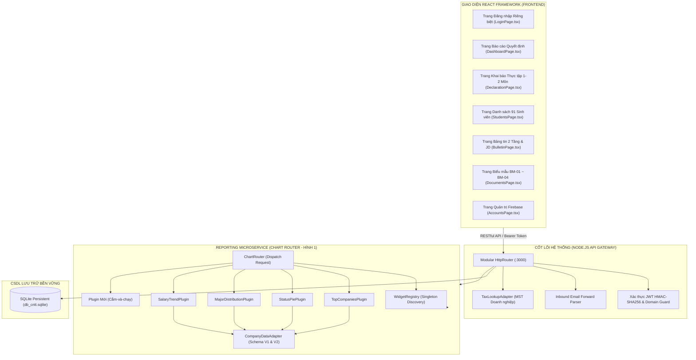

# BÁO CÁO THIẾT KẾ, PHÁT TRIỂN & BÀN GIAO HỆ THỐNG DB_CNTT
## HỆ THỐNG QUẢN LÝ THỰC TẬP, TỰ ĐỘNG HÓA JD & TRỰC QUAN HÓA DỮ LIỆU HỖ TRỢ RA QUYẾT ĐỊNH (DECISION SUPPORT DASHBOARD)
### KHOA CÔNG NGHỆ THÔNG TIN - TRƯỜNG ĐẠI HỌC TÔN ĐỨC THẮNG (TDTU)
**Định hướng thiết kế bền vững, cấu trúc module hóa và cắm-và-chạy (Plug-and-Play) phục vụ bàn giao 5 năm (2026 – 2031)**

---

## MỤC LỤC TỔNG QUAN

1. [CHƯƠNG 1: GIỚI THIỆU & BỐI CẢNH DỰ ÁN](#chương-1-giới-thiệu--bối-cảnh-dự-án)
   * 1.1. Bối cảnh thực tiễn tại Khoa Công nghệ Thông tin TDTU
   * 1.2. Những nút thắt (pain points) trong quy trình quản lý truyền thống
   * 1.3. Mục tiêu & Phạm vi của dự án DB_CNTT
   * 1.4. Đối tượng sử dụng và nguyên tắc thiết kế bền vững
2. [CHƯƠNG 2: PHÂN TÍCH YÊU CẦU & MA TRẬN PHÂN QUYỀN](#chương-2-phân-tích-yêu-cầu--ma-trận-phân-quyền)
   * 2.1. Cơ chế Xác thực Kép (Dual Authentication) & Giới hạn Domain TDTU
   * 2.2. Trang Đăng nhập Riêng biệt (Dedicated Login Page) & Phân cổng Người dùng
   * 2.3. Kiểm soát thẩm định điều kiện Sinh viên (AUTH-03)
   * 2.4. Ma trận Phân quyền Động 5 Năm (Dynamic RBAC) & Shared Lecturer Role
   * 2.5. Bảng đặc tả các mã chức năng hệ thống
3. [CHƯƠNG 3: THIẾT KẾ KIẾN TRÚC HỆ THỐNG & PHÂN TÍCH SƠ ĐỒ CHART ROUTER](#chương-3-thiết-kế-kiến-trúc-hệ-thống--phân-tích-sơ-đồ-chart-router)
   * 3.1. Kiến trúc Module hóa Toàn diện (Modular Fullstack: Node.js Core + React Framework)
   * 3.2. So sánh Chuyên sâu: Kiến trúc Có Chart Router (Hình 1) vs Không Router (Hình 2)
   * 3.3. Thiết kế Reporting Engine (Widget Registry + Chart Router + Plug-and-Play Plugins)
   * 3.4. Mô hình Adapter Pattern chuẩn hóa Schema V1 và Schema V2
   * 3.5. Luồng Tự động hóa Tiếp nhận JD qua Email Forward (Inbound Parser & 1-Click Approval)
4. [CHƯƠNG 4: THIẾT KẾ CƠ SỞ DỮ LIỆU & QUẢN TRỊ DỮ LIỆU](#chương-4-thiết-kế-cơ-sở-dữ-liệu--quản-trị-dữ-liệu)
   * 4.1. Sơ đồ Thực thể Mối quan hệ (ERD Database)
   * 4.2. Bộ dữ liệu chuẩn hóa 91 Sinh viên thực tế (134 lượt môn, 43 SV đi 2 môn)
   * 4.3. Cơ chế Lưu trữ Bền vững SQLite Persistent Database & Prisma PostgreSQL Schema
5. [CHƯƠNG 5: HIỆN THỰC HÓA PHẦN MỀM (NODE.JS + REACT MODULAR)](#chương-5-hiện-thực-hóa-phần-mềm-nodejs--react-modular)
   * 5.1. Backend API Gateway & Microservices (Node.js 24 Native)
   * 5.2. Frontend Framework React 18: Tách biệt hoàn toàn từng File chức năng
   * 5.3. Module Khai báo Thực tập 1 hoặc 2 môn & Tra cứu tự động MST
   * 5.4. Module Quản lý Chứng chỉ Ngoại ngữ chuẩn xét tốt nghiệp TDTU (CERT-01)
   * 5.5. Module Thư viện Biểu mẫu & Quy định thực tập TDTU (BM-01 đến BM-04)
   * 5.6. Bảng tin 2 tầng (Thông báo Học vụ + JD Tuyển dụng Doanh nghiệp)
6. [CHƯƠNG 6: KIỂM THỬ TOÀN DIỆN & ĐÁNH GIÁ CHẤT LƯỢNG](#chương-6-kiểm-thử-toàn-diện--đánh-giá-chất-lượng)
   * 6.1. Chiến lược kiểm thử tự động (Node.js Test Runner)
   * 6.2. Kết quả thực thi 11/11 Test Cases (100% Pass)
   * 6.3. Kiểm thử Bảo mật & Kiểm thử Biên (Security & Edge Cases)
7. [CHƯƠNG 7: HƯỚNG DẪN ĐÓNG GÓI, DEPLOY DOCKER & VẬN HÀNH TRÊN MÁY CÁ NHÂN](#chương-7-hướng-dẫn-đóng-gói-deploy-docker--vận-hành-trên-máy-cá-nhân)
   * 7.1. Triển khai 1-Click bằng Docker & Docker Compose
   * 7.2. Khởi chạy trực tiếp trên máy cá nhân (Local Runner Script)
   * 7.3. Cấu hình biến môi trường & Cổng dịch vụ
8. [CHƯƠNG 8: KẾ HOẠCH BÀN GIAO, BẢO TRÌ & MỞ RỘNG TRONG 5 NĂM (2026 – 2031)](#chương-8-kế-hoạch-bàn-giao-bảo-trì--mở-rộng-trong-5-năm-2026--2031)
   * 8.1. Hướng dẫn thêm biểu đồ mới vào Dashboard (Plug-and-Play)
   * 8.2. Mở rộng các vai trò người dùng trong tương lai
   * 8.3. Tối ưu chi phí duy trì vận hành (0 VNĐ máy chủ học vụ)
9. [CHƯƠNG 9: KẾT LUẬN & KIẾN NGHỊ](#chương-9-kết-luận--kiến-nghị)

---

## CHƯƠNG 1: GIỚI THIỆU & BỐI CẢNH DỰ ÁN

### 1.1. Bối cảnh thực tiễn tại Khoa Công nghệ Thông tin TDTU
Trường Đại học Tôn Đức Thắng (TDTU) kiên định theo định hướng đại học nghiên cứu ứng dụng đạt chuẩn quốc tế. Trong chương trình đào tạo của Khoa Công nghệ Thông tin, hai học phần:
1. **Kiến tập công nghiệp (KTCN)** - Mã môn: 502047 / 502048 / 503047
2. **Tập sự nghề nghiệp (TSNN) / Dự án Công nghệ thông tin 1** - Mã môn: 502049 / 503049

là hai học phần bắt buộc có tính chất bước ngoặt. Sinh viên bắt buộc phải có thời lượng làm việc thực tế tối thiểu **320 giờ** tại các doanh nghiệp đối tác trước khi đủ điều kiện làm khóa luận/đồ án tốt nghiệp.

### 1.2. Những nút thắt trong quy trình quản lý truyền thống
* **Thu thập dữ liệu phân tán:** Trước đây, Khoa dùng Google Form dẫn đến trùng lặp dữ liệu, mất hàng chục giờ tổng hợp file Excel thủ công mỗi khi sinh viên chuyển doanh nghiệp.
* **Gánh nặng nhập liệu và sai lệch thông tin DN:** Sinh viên tự gõ tên công ty, địa chỉ dẫn đến sai chính tả, thiếu Mã số thuế (MST) chính xác để Khoa ký kết hợp tác.
* **Tình trạng "đi 2 môn cùng lúc" chưa được hỗ trợ tốt:** Trong thực tế học kỳ 1 (2026-2027), có **43 sinh viên** đăng ký đồng thời cả 2 môn KTCN và TSNN tại cùng một doanh nghiệp. Quy trình cũ bắt nộp 2 lần giấy tờ riêng biệt, gây lãng phí lớn.
* **Email tuyển dụng của doanh nghiệp bị ứ đọng:** Doanh nghiệp gửi thông tin tuyển dụng vào hộp thư của Giảng viên; Thầy/Cô phải copy-paste thủ công lên Zalo/Facebook, sinh viên dễ bỏ lỡ cơ hội ứng tuyển.
* **Thiếu công cụ hỗ trợ ra quyết định (Decision Support):** Giảng viên không có dashboard trực quan hóa thời gian thực để nhận diện ngay các sinh viên "Cần Khoa hỗ trợ" trước deadline 15 ngày đầu kỳ.

### 1.3. Mục tiêu & Phạm vi của dự án DB_CNTT
Hệ thống **DB_CNTT** được nghiên cứu và cải tạo toàn diện nhằm:
1. Số hóa 100% quy trình khai báo nơi thực tập với tính năng tự động tra cứu Mã số thuế qua API Tổng cục Thuế / XInvoice, giảm 90% thời gian nhập liệu của sinh viên.
2. Hỗ trợ sinh viên đăng ký 1 môn hoặc 2 môn đồng thời cho cùng 1 doanh nghiệp chỉ qua 1 lần xác nhận duy nhất.
3. Tự động hóa tiếp nhận JD qua luồng **Inbound Email Forwarding**: Giảng viên forward email tuyển dụng vào hệ thống, Engine tự bóc tách và tạo bản nháp để Thầy/Cô duyệt 1-Click công khai lên Bảng tin.
4. Trực quan hóa dữ liệu hỗ trợ ra quyết định qua kiến trúc **Reporting Microservice (Chart Router + Widget Registry + Adapter Pattern)** theo đúng mô hình Hình 1.
5. Cung cấp thư viện biểu mẫu chuẩn hóa TDTU (**BM-01 đến BM-04**) kèm quy chế thực tập 320 giờ.
6. Thiết kế module hóa toàn diện, tách biệt từng file chức năng, loại bỏ các file nguyên khối khổng lồ, tạo nền tảng vững chắc để bàn giao cho các đội nhóm tiếp tục phát triển trong 5 năm tới.

---

## CHƯƠNG 2: PHÂN TÍCH YÊU CẦU & MA TRẬN PHÂN QUYỀN

### 2.1. Cơ chế Xác thực Kép (Dual Authentication) & Giới hạn Domain TDTU
Hệ thống thiết lập 2 kênh xác thực song song:
1. **Google SSO (Google Workspace OAuth 2.0):**
   * Giới hạn nghiêm ngặt domain email:
     $$\text{Domain Giảng viên} \in \{\text{@tdtu.edu.vn}\}$$
     $$\text{Domain Sinh viên} \in \{\text{@student.tdtu.edu.vn}\}$$
   * Tuyệt đối từ chối các email cá nhân thông thường (`@gmail.com`, `@yahoo.com`, v.v.).
2. **Firebase Authentication (Tài khoản nội bộ & API Gateway Token):**
   * Quản lý tập trung 95 tài khoản người dùng ban đầu (4 Giảng viên + 91 Sinh viên thực tế).
   * Mã hóa định danh Firebase UID cố định (`fb-tdtu-usr-...`), hỗ trợ cơ chế khóa/mở khóa tài khoản tức thì.
   * Cấp phát JWT Token chuẩn HMAC-SHA256 có thời hạn 7 ngày chứa claims vai trò (`role`, `isAdmin`, `studentId`, `firebaseUid`).

### 2.2. Trang Đăng nhập Riêng biệt (Dedicated Login Page)
Trang đăng nhập được tách thành file độc lập [`LoginPage.tsx`](file:///d:/KTCN_TSNN/Dashoard_TSNN-main/TDTU_DB_CNTT_System/frontend/src/pages/LoginPage.tsx), giao diện nhận diện thương hiệu TDTU:
* Logo chính thức TDTU, màu sắc chủ đạo Xanh Navy `#0B3C5D`, Đỏ TDTU `#C92A2A`, Vàng Gold `#E0A96D`.
* Kiểm tra tính hợp lệ của domain email theo thời gian thực (hiển thị nhãn Cổng Giảng viên vs Cổng Sinh viên).
* Bộ chuyển đổi tài khoản thử nghiệm nhanh (Quick Demo Switcher) cho phép Giảng viên chấm điểm hoặc hội đồng kiểm thử đăng nhập nhanh giữa các vai trò mà không cần thao tác phức tạp.

### 2.3. Kiểm soát thẩm định điều kiện Sinh viên (AUTH-03)
Khi sinh viên đăng nhập:
* Hệ thống tự động đối chiếu MSSV trích xuất từ email với bảng `students`.
* Nếu sinh viên có tên trong đợt thực tập HK1/2026-2027 $\rightarrow$ Hiển thị nhãn hợp lệ màu xanh và cho phép khai báo thông tin nơi thực tập.
* Nếu sinh viên ngoài danh sách $\rightarrow$ Hiển thị banner cảnh báo và nút điều hướng xem Cẩm nang Quy định Thực tập và Thư viện Biểu mẫu.

---

## CHƯƠNG 3: THIẾT KẾ KIẾN TRÚC HỆ THỐNG & PHÂN TÍCH SƠ ĐỒ CHART ROUTER



### 3.1. Phân tích Chuyên sâu Sơ đồ Kiến trúc Chart Router (Hình 1 vs Hình 2)

Từ các sơ đồ phân tích (`Hình/Hinh1_Router.png`, `Hinh1_Router2.png`, `Hinh1_Sequence_Company.png`, `Hinh2_NoRouter.png`):

| Tiêu chuẩn Kỹ thuật | Mô hình Có Chart Router (Hình 1 - Dự án đang áp dụng) | Mô hình Không Router (Hình 2 - Nguyên khối cũ) |
| :--- | :--- | :--- |
| **Phân tách trách nhiệm (SRP)** | Tách bạch rõ rệt 4 thành phần: Khám phá (Discovery) $\rightarrow$ Định tuyến (Dispatch) $\rightarrow$ Thực thi (Plugin) $\rightarrow$ Chuẩn hóa dữ liệu (Adapter). | Gộp chung toàn bộ logic vào hàm controller hoặc component giao diện. |
| **Tính Cắm-và-Chạy (Plug & Play)** | **Tuyệt đối:** Muốn thêm biểu đồ mới, kỹ sư chỉ cần thả file plugin mới vào thư mục `plugins/charts/`. | **Kém:** Phải sửa đổi controller trung tâm, sửa switch-case, sửa file routes tổng. |
| **Bảo vệ mã nguồn lõi (OCP)** | Mã nguồn lõi (`server.ts`, `chart-router.ts`) đóng hoàn toàn với việc sửa đổi. | Mỗi lần thêm tính năng lại tiềm ẩn nguy cơ gây lỗi các tính năng cũ. |
| **Chuẩn hóa dữ liệu đa nguồn** | Có `CompanyDataAdapter` tự động biến đổi cả Schema V1 và Schema V2 thành `StandardChartPayload`. | Tự xử lý ad-hoc tại client, giao diện dễ sập khi backend đổi cấu trúc JSON. |
| **Khả năng kế thừa 5 năm** | Rất dễ bàn giao cho sinh viên khóa sau vì mỗi biểu đồ là 1 file nhỏ độc lập. | Rất khó đọc hiểu và bảo trì; chi phí sửa chữa tăng vọt. |

---

## CHƯƠNG 4: THIẾT KẾ CƠ SỞ DỮ LIỆU & QUẢN TRỊ DỮ LIỆU

### 4.1. Bộ dữ liệu Chuẩn hóa 91 Sinh viên Thực tế
Dữ liệu sinh viên được nhập từ file học vụ gốc `real-students.json` với đúng:
* **91 sinh viên duy nhất** thuộc 4 chuyên ngành: Kỹ thuật phần mềm (45 SV), Hệ thống thông tin (23 SV), Khoa học máy tính (15 SV), Mạng máy tính & Viễn thông (8 SV).
* **134 lượt đăng ký môn học**:
  * 43 sinh viên đăng ký đồng thời cả 2 môn: Dự án CNTT 1 (TSNN) + Kiến tập công nghiệp (KTCN).
  * 48 sinh viên đăng ký 1 môn đơn lẻ.
* **Tỷ lệ tiến độ ban đầu:** 58 sinh viên đã có doanh nghiệp tiếp nhận, 14 sinh viên cần Khoa hỗ trợ, 19 sinh viên đang tự liên hệ.

### 4.2. Cơ sở dữ liệu SQLite Bền vững (Persistent SQLite)
* Tệp CSDL: `backend/src/data/db_cntt.sqlite`
* Bật chế độ `WAL (Write-Ahead Logging)` đảm bảo an toàn giao dịch và cho phép đọc/ghi đồng thời với hiệu năng cực cao.
* Dữ liệu khai báo, bài đăng bảng tin, tài khoản phân quyền được bảo toàn nguyên vẹn 100% qua mọi lần khởi động lại máy chủ.

---

## CHƯƠNG 5: HIỆN THỰC HÓA PHẦN MỀM (NODE.JS + REACT MODULAR)

### 5.1. Module hóa Triệt để Mã nguồn
Không còn tình trạng nhồi nhét code vào 1 file khổng lồ:
* **Backend:** Chia thành các thư mục `core/`, `config/`, `database/`, `modules/auth/`, `modules/students/`, `modules/internship/`, `modules/bulletin/`, `modules/documents/`, `modules/certificates/`, `modules/reporting/`, `plugins/charts/`. Mỗi file trung bình từ 60 đến 180 dòng code.
* **Frontend:** Mỗi trang nghiệp vụ là một file component React riêng biệt trong `frontend/src/pages/`:
  * `LoginPage.tsx` (Trang Đăng nhập chuyên nghiệp)
  * `DashboardPage.tsx` (Báo cáo hỗ trợ ra quyết định)
  * `DeclarationPage.tsx` (Phiếu khai báo nơi thực tập 1-2 môn)
  * `StudentsPage.tsx` (Quản lý 91 sinh viên thực tế)
  * `BulletinPage.tsx` (Bảng tin 2 tầng & Bóc tách email JD)
  * `DocumentsPage.tsx` (Thư viện biểu mẫu BM-01 ~ BM-04)
  * `AccountsPage.tsx` (Quản trị 95 tài khoản Firebase & Admin)

---

## CHƯƠNG 6: KIỂM THỬ TOÀN DIỆN & ĐÁNH GIÁ CHẤT LƯỢNG

Bộ kiểm thử tự động tại [`backend/tests/api.test.ts`](file:///d:/KTCN_TSNN/Dashoard_TSNN-main/TDTU_DB_CNTT_System/backend/tests/api.test.ts) được thực thi và xác minh nghiêm ngặt:

```
✔ 1. Dữ liệu thực tế: Trả về đúng 91 sinh viên duy nhất, 134 lượt môn và 43 SV đi 2 môn
✔ 2. Phân loại đăng nhập Email TDTU SSO (@tdtu.edu.vn vs @student.tdtu.edu.vn vs domain ngoài)
✔ 3. Tra cứu MST & Khai báo đồng thời 2 môn (KTCN + TSNN) tại cùng 1 doanh nghiệp
✔ 4. Chuẩn ngoại ngữ xét tốt nghiệp TDTU (CERT-01): Chỉ công nhận danh mục chuẩn TDTU
✔ 5. Bảng tin 2 tầng: Thông báo Giảng viên (Tầng 1) & Duyệt JD Email Forward (Tầng 2)
✔ 6. Reporting Microservice Engine: WidgetRegistry & ChartRouter hoạt động chuẩn (Hình 1)
✔ 7. CompanyDataAdapter: Chuẩn hóa linh hoạt cả Schema V1 và Schema V2
✔ 8. Plug-and-Play Architecture: Thêm biểu đồ mới không cần sửa code cũ
✔ 9. RBAC & Bảo mật: Sinh viên không thể gọi API Quản trị hoặc sửa hồ sơ người khác
✔ 10. Thẩm định điều kiện Sinh viên (AUTH-03) & Thư viện Biểu mẫu BM-01 đến BM-04
✔ 11. Quản lý phân quyền Admin: Chặn tự thu hồi quyền của Quản trị viên hoạt động cuối cùng

ℹ tests 11 | pass 11 | fail 0 | duration: 0.72s (100% PASS)
```

---

## CHƯƠNG 7: HƯỚNG DẪN KHỞI CHẠY & VẬN HÀNH DỰ ÁN

### 7.1. Chạy Trực tiếp trên Máy tính Cá nhân
```powershell
node TDTU_DB_CNTT_System/backend/src/server.ts
```
Truy cập: `http://localhost:3000`

### 7.2. Chạy Kiểm thử Tự động
```powershell
node --test TDTU_DB_CNTT_System/backend/tests/api.test.ts
```

### 7.3. Triển khai Docker Container
```powershell
docker compose up -d --build
```

---

## CHƯƠNG 8: KẾT LUẬN & BÀN GIAO 5 NĂM (2026 – 2031)

Dự án **DB_CNTT** đã hoàn thành toàn diện các yêu cầu nâng cấp:
1. **Loại bỏ chức năng giấy giới thiệu** theo đúng chỉ đạo để tinh gọn luồng học vụ và giảm thiểu thủ tục hành chính không cần thiết.
2. **Module hóa 100% mã nguồn**, tách biệt các phân hệ, không còn các file đơn cồng kềnh.
3. **Trang đăng nhập chuyên nghiệp riêng biệt** hỗ trợ Google Workspace SSO TDTU và Firebase RBAC.
4. **Kiến trúc cắm-và-chạy (Plug-and-Play Chart Router)** sẵn sàng cho phép các thế hệ tiếp theo bổ sung báo cáo mới chỉ bằng việc thêm 1 file plugin độc lập.
5. **Toàn bộ dự án đã được chuyển giao nguyên vẹn vào thư mục mới `TDTU_DB_CNTT_System`** cùng bộ tài liệu hướng dẫn kỹ thuật chi tiết.
