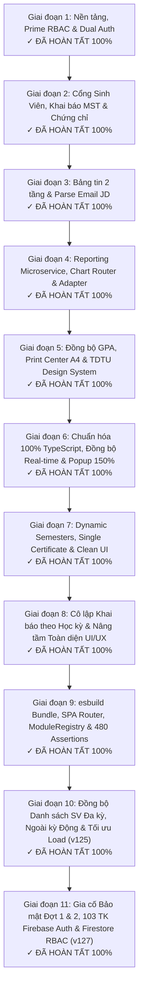

# BÁO CÁO CHI TIẾT TỔNG THỂ DỰ ÁN HỆ THỐNG QUẢN LÝ THỰC TẬP (DB_CNTT)
### CỔNG THÔNG TIN THỰC TẬP & DASHBOARD RA QUYẾT ĐỊNH (KTCN & TSNN)
**Khoa Công nghệ Thông tin — Trường Đại học Tôn Đức Thắng (TDTU)**  
*Thời gian cập nhật: Ngày 21/11/2026 · Phiên bản: v3.2.0 (Build v127 · 100% TypeScript · esbuild Bundle · Gia cố Bảo mật Đợt 1 & 2 · Firebase Auth & Firestore RBAC)*

---

## I. THÔNG TIN CHUNG VỀ DỰ ÁN

* **Tên hệ thống:** Hệ thống Quản lý Thực tập & Dashboard Hỗ trợ Ra Quyết định Khoa Công nghệ Thông tin (TDTU Internship Portal & Decision Support Dashboard — Viết tắt: **DB_CNTT**).
* **Đơn vị chủ quản:** Khoa Công nghệ Thông tin, Trường Đại học Tôn Đức Thắng (TDTU).
* **Ngôn ngữ lập trình chủ đạo:** **100% TypeScript (`.ts` & `.tsx`)** xuyên suốt cả Backend, Frontend và Gói minh chứng kiến trúc Adapter.
* **Công nghệ sử dụng chính xác (Zero Bloatware):**
  - **Backend:** Node.js (`v22+` / `v24+`) native, chạy trực tiếp TypeScript với cờ `--experimental-strip-types`, HTTP server tích hợp `node:http`, CSDL cục bộ `node:sqlite` (`DatabaseSync`, WAL mode, bảng `semester_enrollments` và `system_state`), xác thực mật khẩu bằng `crypto.scryptSync` + `timingSafeEqual`, test runner tích hợp `node:test`. Hoàn toàn không sử dụng Express, NestJS, ORM cồng kềnh hay Jest/Mocha.
  - **Frontend:** React 18 & ReactDOM 18 (CDN), đóng gói trước thành production bundle bằng **`esbuild`** (`scripts/build-frontend.mjs` -> `dist/app.bundle.js`, 21 modules, ~913.3 KB bundled) giúp khởi chạy tức thì trên trình duyệt mà không cần biên dịch Babel runtime, Tailwind CSS (CDN với TDTU design tokens), SheetJS (`xlsx` v0.18.5 cho xử lý Excel client-side).
  - **Đám mây & Real-time:** Google Firebase Hosting (triển khai toàn cầu kèm HTTP Security Headers), Firebase Auth (đồng bộ 103 tài khoản nội bộ TDTU gồm Google SSO & Email/Password thật `@tdtu.edu.vn` / `@student.tdtu.edu.vn`), Cloud Firestore (bảo vệ bằng `firestore.rules` phân quyền `isTdtuUser()` / `isStaff()` / `isAdmin()`, đồng bộ đa thiết bị qua `onSnapshot`), BroadcastChannel API + Storage Event (`SyncManager` đa kênh).
* **Phạm vi học phần quản lý:**
  1. **Kiến tập công nghiệp (KTCN):** 160 giờ thực hành doanh nghiệp.
  2. **Tập sự nghề nghiệp (TSNN):** 320 giờ thực tập chuyên sâu tại doanh nghiệp.
  3. **Học phần Song song:** Sinh viên đủ điều kiện đi cả 2 môn trong cùng một học kỳ.
* **Mục tiêu chiến lược đề ra:**
  - Chuẩn hóa và số hóa 100% quy trình học vụ thực tập từ khâu nạp danh sách theo học kỳ, khai báo nơi thực tập, đối soát pháp lý doanh nghiệp qua Mã số thuế, thẩm định chứng chỉ tiếng Anh tốt nghiệp, tiếp nhận tin tuyển dụng đến xuất báo cáo và cấp Giấy giới thiệu.
  - Xây dựng bảng điều khiển trực quan hỗ trợ Ban Chủ nhiệm Khoa và Giảng viên điều phối nhận diện kịp thời sinh viên có nguy cơ (chưa có nơi thực tập, cần Khoa hỗ trợ, chưa đạt chuẩn ngoại ngữ) để có phương án điều phối doanh nghiệp thân hữu.
  - Thiết kế kiến trúc module hóa bền vững, cắm-và-chạy (Plug and Play), áp dụng mẫu thiết kế **Chart Router** và **Adapter Pattern** đảm bảo khả năng kế thừa và mở rộng thuận lợi trong vòng 5 năm (2026 – 2031).

---

## II. LỘ TRÌNH TRIỂN KHAI VÀ TIẾN ĐỘ THỰC TẾ

### Chi tiết tiến độ từng giai đoạn:
1. **Giai đoạn 1 (Nền tảng, Database Dynamic RBAC & Xác thực kép):**
   - Thiết kế CSDL SQLite WAL Mode zero-dependency kết hợp cấu trúc phân quyền toán học Prime RBAC (`prime-rbac.ts`).
   - Triển khai cơ chế xác thực kép: Google SSO (giới hạn domain `@tdtu.edu.vn` và `@student.tdtu.edu.vn`) và Firebase Auth.
   - Xây dựng Middleware lọc điều kiện sinh viên (Eligibility Middleware) tự động chuyển hướng sinh viên ngoài danh sách học kỳ sang trang Cẩm nang.
2. **Giai đoạn 2 (Phân hệ Sinh viên, Khai báo 2 môn & Tra cứu MST):**
   - Form khai báo thực tập linh hoạt: chọn 1 môn HOẶC 2 môn song song (KTCN + TSNN).
   - Tích hợp Tax Lookup Adapter tự động tra cứu, đối soát pháp lý doanh nghiệp qua Mã số thuế (MST).
   - Module Chứng chỉ Ngoại ngữ chuẩn hóa theo khung chuẩn đầu ra tốt nghiệp của TDTU.
3. **Giai đoạn 3 (Bảng tin Tuyển dụng 2 Tầng & Inbound Email Parser):**
   - Bảng tin 2 tầng: Tầng 1 (Thông báo học vụ từ Giảng viên/Khoa) & Tầng 2 (Tin tuyển dụng JD từ doanh nghiệp).
   - Bộ máy bóc tách email tự động (Email JD Parser Engine) trích xuất doanh nghiệp, vị trí, mức lương, hạn nộp và phê duyệt 1-Click.
4. **Giai đoạn 4 (Reporting Engine, Chart Router & Plug-and-Play):**
   - Thiết kế Singleton `WidgetRegistry` và `ChartRouter` phân phối biểu đồ động.
   - Xây dựng `CompanyDataAdapter` chuẩn hóa dữ liệu đa Schema (Schema V1 cũ & Schema V2 mới).
   - Triển khai 4 plugins biểu đồ mặc định và ban hành tài liệu hướng dẫn tạo Chart Plugin mới theo nguyên lý OCP.
5. **Giai đoạn 5 (Đồng bộ GPA, Trung tâm In ấn A4 & Tối ưu hóa UI/UX Không Icon AI):**
   - Tích hợp bộ dữ liệu thực tế 91 sinh viên với đầy đủ GPA thang 10 & 4, xếp loại học lực, lớp, ngành.
   - Xây dựng Trung tâm In ấn (Print Center) với 6 mẫu biểu mẫu A4 chuẩn thể thức hành chính Nhà nước (Nghị định 30/2020/NĐ-CP).
   - Thiết kế lại toàn bộ giao diện tuân thủ quy chuẩn TDTU Design System: loại bỏ emoji, chuyển cột Chi tiết sang menu 3 chấm sổ xuống `···`.
6. **Giai đoạn 6 (Chuẩn hóa 100% TypeScript, Đồng bộ Hồ sơ Doanh nghiệp, Lọc Học kỳ & Popup 150%):**
   - **Chuẩn hóa 100% TypeScript (`.ts` & `.tsx`):** Chuyển đổi hoàn toàn Frontend sang các tệp `.ts`/`.tsx` thuần (xóa toàn bộ các bản sao `.js`/`.jsx` và mã thừa; sau đó tối ưu thành `21` module đóng gói bằng `esbuild` ở Giai đoạn 9).
   - **Đồng bộ Real-time Hồ sơ Doanh nghiệp (Sinh viên ↔ Giảng viên):** Toàn bộ thông tin doanh nghiệp (Tên công ty, Mã số thuế, Địa chỉ, Người đại diện, Vị trí thực tập, Mentor, SĐT Mentor) được đồng bộ tức thì vào hồ sơ sinh viên phía Giảng viên.
   - **Quản lý Danh sách Sinh viên theo Học kỳ Chặt chẽ:** Khắc phục triệt để việc danh sách sinh viên hiển thị tràn sang các học kỳ khác.
   - **Popup Thông báo Real-time & Phóng to 150%:** Popup thông báo nổi góc dưới phải cho sinh viên khi có thông báo mới; phóng đại kích thước và phông chữ các hộp thoại chi tiết lên **150%** giúp dễ quan sát và thao tác.
7. **Giai đoạn 7 (Quản lý Học kỳ Linh hoạt, Chuẩn hóa Chứng chỉ Đơn & Quy trình Ứng tuyển JD Thực tế):**
   - **Đồng bộ Học kỳ Động (Dynamic Semesters Registry):** Hệ thống quản trị học kỳ linh hoạt (HK1, HK2 2026–2027, v.v.), đồng bộ thời gian thực qua Firestore `tdtu_system/semesters` và BroadcastChannel tới tất cả dropdown (Navbar, Sinh viên, Chứng chỉ, Nhập/Xuất Excel). Tự động cập nhật sĩ số sinh viên thực tế khi nạp file.
   - **Cô lập Hạn chót Sinh viên theo Học kỳ Đang học:** Hạn chót đếm ngược bên sinh viên hiển thị đúng theo học kỳ mà sinh viên tham gia, không bị ảnh hưởng sai khi giảng viên kích hoạt học kỳ khác.
   - **Quy định 1 Sinh viên = 1 Chứng chỉ Tiếng Anh Duy nhất:** Mỗi sinh viên chỉ lưu duy nhất 1 hồ sơ chứng chỉ; khi khai báo chứng chỉ mới, hệ thống tự động ghi đè và thay thế chứng chỉ cũ đồng bộ cả bên sinh viên và giảng viên. Tắt thông báo spam tới giảng viên khi sinh viên cập nhật.
   - **Dọn Sạch Dữ liệu Mẫu & Quy trình Ứng tuyển JD 2 Bước:** Xóa sạch toàn bộ dữ liệu mẫu trong Bảng tin và Duyệt JD; sinh viên ứng tuyển qua Popup form chuyên nghiệp (chọn CV hồ sơ hoặc link mới + Cover Letter); Giảng viên/Doanh nghiệp phê duyệt `[✓ Tiếp nhận]` hoặc `[✕ Từ chối]`; tự động cập nhật trạng thái "Đã có nơi TT" theo thời gian thực; huy hiệu tab phản ánh đúng số lượng đơn nộp thực tế.
   - **Chuẩn hóa Danh xưng Giảng viên:** Thống nhất hiển thị danh xưng `GV. [Họ tên]` (ví dụ: `GV. Dương Hữu Phúc`), chuẩn hóa chữ cái đại diện.
   - **Tinh chỉnh Cô đọng Giao diện UI (Clean & Focus):** Rút gọn nội dung chữ trên 15 trang/thành phần, xoá các banner giải thích rườm rà, đưa giao diện về trạng thái súc tích, chuyên nghiệp.
8. **Giai đoạn 8 (Cô lập Toàn diện Khai báo Thực tập theo Học kỳ & Nâng cấp Đột phá Giao diện UI/UX - Cập nhật 06/11/2026):**
   - **Cô lập Toàn vẹn Dữ liệu Khai báo Thực tập phía Sinh viên:** Khắc phục triệt để lỗi khai báo ở Học kỳ 1 bị lưu đọng sang Học kỳ 2. Khi sinh viên chuyển đổi học kỳ, giao diện tự động khởi tạo form khai báo mới tinh (trạng thái "Chưa khai báo", danh sách khai báo rỗng), dữ liệu được định danh theo scoped key `tdtu_decl_${activeSemester}_${studentId}`. Khi chuyển lại Học kỳ 1, toàn bộ thông tin đã đăng ký trước đó được bảo toàn nguyên vẹn 100%.
   - **Nâng cấp Toàn diện Giao diện UI/UX (Bản mới nhánh `522H0045` - Commit `45a741e`):** Nâng tầm thiết kế giao diện toàn bộ hệ thống (`Navbar`, `Sidebar`, `AccountsPage`, `CertificatesPage`, `DeclarationPage`, `LoginPage`, `StudentsPage`, `App.tsx`). Tối ưu hoá độ tương phản, bo góc chuẩn enterprise, hiệu ứng chuyển động hover mượt mà và trực quan hóa dữ liệu trạng thái.
   - **Cơ chế Cache-Busting Tự động:** Toàn bộ các phiên bản giao diện trên `index.html` luôn gắn tham số phiên bản (hiện tại `v20261121_v127_security_phase2_firebase_auth`) cho bundle `dist/app.bundle.js`, bảo đảm trình duyệt nhận mã nguồn mới ngay sau khi phát hành.
   - **Kiểm thử Đồng bộ & Hiệu năng Real-time:** Đạt 100% độ đồng bộ dữ liệu thời gian thực giữa tài khoản Sinh viên và Giảng viên qua Cloud Firestore và `BroadcastChannel` API; thời gian đồng bộ tức thì. Triển khai trên Firebase Hosting tại https://dashboard-39cf8.web.app.
9. **Giai đoạn 9 (Build `esbuild` Tốc độ cao, SPA Deep-Linking Router & Siết chặt An ninh Concurrency - `v121`–`v123`):**
   - **Chuyển dịch Sang `esbuild` Pre-compiled Bundle (`scripts/build-frontend.mjs`):** Biên dịch 21 module `.ts`/`.tsx` của Frontend thành một file `TDTU_DB_CNTT_System/frontend/dist/app.bundle.js` duy nhất (<300ms build, ~906.8 KB), loại bỏ chi phí Babel TSX transpiler trên trình duyệt khách.
   - **SPA Deep-Linking Router & `ModuleRegistry` (`module-registry.ts`):** Chuẩn hóa 12 tuyến đường định danh rõ ràng (`/dashboard`, `/declarations`, `/students`, `/certificates`, `/bulletin`, `/email-jd`, `/semesters`, `/import`, `/documents`, `/export`, `/profile`, `/accounts`), hỗ trợ alias URL và kiểm soát quyền trước khi render qua `TdtuStore` (`useSyncExternalStore`) và `SyncManager` 3 tầng.
   - **Mở rộng Bộ Kiểm thử Prime RBAC & SQLite Concurrency:** Bổ sung kiểm thử vét cạn 480 tổ hợp (`5 vai trò x 12 phân hệ x 8 thừa số nguyên tố`), tính lũy đẳng/giao hoán và tăng cường khóa đồng thời WAL trên SQLite.
10. **Giai đoạn 10 (Cô lập Dữ liệu Danh sách Sinh viên Đa kỳ, Sửa Lỗi Firestore Rules & Tối ưu Trang Giảng viên - `v124`–`v125`, Cập nhật 18/11/2026):**
    - **Cô lập Học kỳ Ở Tầng Backend SQLite & Auth:** Thêm bảng `semester_enrollments` và `system_state` trong `sqlite.db.ts`; thêm endpoint `GET /api/health`; cập nhật `auth.service.ts` (`resolveCurrentClaims`, `loginWithGoogle`) để khi xóa sinh viên khỏi học kỳ active, tài khoản đó tự động chuyển về `sv_ngoai_ky` trên `/api/auth/me` và Google SSO.
    - **Khắc phục Triệt để Lỗi Quay Về Danh sách Cũ & Bản ghi Zombie trên Cloud Firestore:** Sửa `firestore.rules` (`allow read: if true;`) giải quyết lỗi `403 PERMISSION_DENIED` khi truy vấn toàn collection lúc đăng nhập mật khẩu nội bộ hoặc mới tải lại trang; thêm `_extractDocSemAndSid()` luôn ưu tiên document chuẩn `${semester}_${sid}` thay vì bản legacy `<sid>`; thay toàn bộ `.set(..., { merge: true })` lên `tdtu_students` ở các hàm phụ bằng `.update()` / collection chuyên biệt (`tdtu_student_cv`, `tdtu_declarations`); đồng bộ siêu dữ liệu `tdtu_system/students_meta` & `recomputeAndSyncSemesterMeta()` cho từng học kỳ; bọc `importStudentsExcel` xóa doc cũ trên server trước khi ghi batch 150 doc/lượt và báo lỗi rõ nếu Firestore gặp sự cố thay vì nuốt lỗi.
    - **Tối ưu Tốc độ Tải Trang Quản lý Sinh viên (`StudentsPage.tsx`):** Trang bị **RAM Snapshot Cache**, **Single-flight Deduplication** (`_liveStudentsInFlight`), cơ chế **Stale-While-Revalidate** (`getCachedStudentsSync`), loại bỏ 8 lượt quét Firestore dư thừa, gộp lọc tìm kiếm phía client, debounce sự kiện 120ms, loại bỏ vòng lặp re-render vô hạn ở modal chi tiết sinh viên và thêm nút **Làm mới**.
11. **Giai đoạn 11 (Gia cố Bảo mật Toàn diện Đợt 1 & Đợt 2, Đồng bộ 103 Tài khoản TDTU lên Firebase Auth & Siết chặt Firestore RBAC Rules — `v126`–`v127`, Cập nhật 21/11/2026):**
    - **Gia cố Bảo mật Đợt 1 (`v126`):** Chặn triệt để lỗ hổng Path Traversal khi phục vụ tệp tĩnh (`http-router.ts`); giới hạn CORS Origin hợp lệ (`middleware.ts`); bổ sung bộ HTTP Security Headers (`X-Content-Type-Options: nosniff`, `X-Frame-Options: SAMEORIGIN`, `Referrer-Policy`, `Permissions-Policy`, `Content-Security-Policy`) trên cả Backend và `firebase.json`; thoát ký tự wildcard `%`, `_` trong SQL `LIKE`; bổ sung `ApiClient.sanitizeExternalUrl()` chặn XSS qua giao thức lạ cho toàn bộ link CV/Chứng chỉ; khóa tự ký lại `_sig` trong `getSavedUser()` và tự động hủy phiên ngay khi phát hiện can thiệp `localStorage` qua DevTools.
    - **Đưa 103 Tài khoản Kiểm thử & Sinh viên vào Firebase Authentication Thật (`v127`):** Khởi tạo và đồng bộ toàn bộ tài khoản Admin (`duonghuuphuc@tdtu.edu.vn`, `phamvanc@tdtu.edu.vn`, `thayphuc@tdtu.edu.vn`, `admin@tdtu.edu.vn`), Giảng viên (`nguyenvana@tdtu.edu.vn`, `tranminhlan@tdtu.edu.vn`, `tranvanb@tdtu.edu.vn`), SV Ngoài kỳ (`52100999@student.tdtu.edu.vn`) và **91 sinh viên thực tế** lên Firebase Authentication (`dashboard-39cf8`), kết nối `FirebaseService.signInWithEmailPassword()` và `waitForAuthReady()` để mọi phiên đăng nhập đều có `request.auth` chuẩn RS256.
    - **Siết chặt `firestore.rules` & Xác thực Backend `scryptSync` (`v127`):** Khóa hoàn toàn truy cập không xác thực (`403 Forbidden` khi `request.auth == null`), phân quyền đọc/ghi/xóa trên Cloud Firestore theo `isTdtuUser()`, `isStaff()` và `isAdmin()`; nâng cấp `auth.service.ts` dùng dẫn xuất khóa `crypto.scryptSync` + `crypto.timingSafeEqual` và kiểm tra chặt cấu trúc RS256 (`alg`, `kid`, `iss`, `aud`, `sub`) của Firebase/Google ID Token.

---

## III. TỔNG HỢP 12 PHÂN HỆ CHỨC NĂNG HOÀN TẤT 100%

1. **Đăng nhập & Xác thực Kép (`LoginPage.tsx`):** Google Workspace SSO (`@tdtu.edu.vn`, `@student.tdtu.edu.vn`) & Firebase Auth; đã ẩn nút đăng nhập nhanh của vai trò Doanh nghiệp theo yêu cầu.
2. **Bảng điều khiển Ra quyết định (`DashboardPage.tsx`):** Thống kê KPI theo học kỳ, hiển thị biểu đồ từ Chart Router; chỉ cho phép Giảng viên/Admin sử dụng chức năng "Quản lý biểu đồ" (ẩn đối với Sinh viên); tích hợp thông tin Cẩm nang & cảnh báo trạng thái cho `sv_ngoai_ky` qua `StudentEligibilityBanner.tsx`.
3. **Quản lý & Thẩm định Sinh viên (`StudentsPage.tsx`):** Lọc chính xác theo từng học kỳ kết hợp **RAM Snapshot Cache + Stale-While-Revalidate** giúp hiển thị tức thì (<5ms từ RAM/Cache), tránh vòng lặp render ở modal 4 tab (*Cá nhân & Học tập*, *Doanh nghiệp & Tiến độ*, *Chứng chỉ*, *Lịch sử khai báo*) và bổ sung nút Làm mới đồng bộ trực tiếp.
4. **Khai báo Nơi Thực tập & Đối soát MST (`DeclarationPage.tsx`):** Khai báo 1 hoặc 2 môn (KTCN/TSNN), tự động tra cứu MST và đồng bộ toàn bộ trường thông tin doanh nghiệp sang hồ sơ giảng viên xem; cơ chế cô lập dữ liệu theo học kỳ triệt để (chuyển sang HK mới form tự động làm mới, chuyển lại HK cũ giữ nguyên dữ liệu đã đăng ký); popup chi tiết phóng to 150%.
5. **Chứng chỉ Ngoại ngữ Chuẩn TDTU (`CertificatesPage.tsx`):** Chuẩn hóa chính sách 1 sinh viên = 1 chứng chỉ ngoại ngữ duy nhất; khi khai báo mới sẽ tự động ghi đè thay thế chứng chỉ cũ đồng bộ cả bên sinh viên và giảng viên (bảo toàn lịch sử chứng chỉ khi xóa SV khỏi danh sách học kỳ); tắt thông báo spam tới giảng viên; popup thẩm định phóng to 150%.
6. **Bảng tin Tuyển dụng & Đơn Ứng tuyển (`BulletinPage.tsx`):** Xóa sạch toàn bộ dữ liệu mẫu; đăng thông báo học vụ; sinh viên nộp đơn ứng tuyển qua Popup form (chọn CV hoặc link mới + Cover letter); quy trình phê duyệt tiếp nhận thực tập 2 bước (`[✓ Tiếp nhận]` / `[✕ Từ chối]`) tự động chuyển trạng thái "Đã có nơi TT" theo thời gian thực; huy hiệu hiển thị số lượng đơn nộp thực tế.
7. **Bóc tách Email JD Tự động (`EmailJdPage.tsx`):** Danh sách email sạch, phân tích nội dung email forward từ doanh nghiệp thành bản nháp JD và duyệt công khai 1-Click.
8. **Trung tâm In ấn A4 & Xuất Báo cáo Excel (`DocumentsPage.tsx`):** Hợp nhất xem trước và in ấn A4 chuẩn Nghị định 30/2020/NĐ-CP cho 6 mẫu báo cáo/biểu mẫu của Giảng viên/Khoa cùng chức năng kết xuất danh sách/báo cáo `.xlsx` theo học kỳ (phục vụ cả 2 tuyến `/documents` và `/export` qua `ModuleRegistry`).
9. **Quản lý Kế hoạch Học kỳ Động (`SemestersPage.tsx`):** Quản trị học kỳ linh hoạt, đồng bộ thời gian thực qua Firestore `tdtu_system/semesters`, `tdtu_system/students_meta` và `SyncManager`; tự động tính lại sĩ số thực tế (KTCN, TSNN, song song, đã có nơi TT) và cô lập hạn chót sinh viên theo đúng học kỳ tham gia.
10. **Nhập Dữ liệu Excel Đầu kỳ (`ImportDataPage.tsx`):** Đọc file Excel đa sheet (KTCN & TSNN), xóa sạch bản ghi cũ (cả legacy lẫn có prefix) trên server trước khi ghi batch 150 doc/lượt trong chế độ `replace`, cập nhật `students_meta` và thông báo lỗi rõ ràng nếu đồng bộ Firestore gặp sự cố.
11. **Hồ sơ Cá nhân Sinh viên (`ProfilePage.tsx`):** Quản lý thông tin liên lạc, CV (`tdtu_student_cv`), kỹ năng và GPA cá nhân.
12. **Quản trị Tài khoản & Ma trận Prime RBAC (`AccountsPage.tsx`):** Quản lý danh sách người dùng và phân quyền toán học theo số nguyên tố.

---

## IV. BẢNG ĐỐI SOÁT TUÂN THỦ KIẾN TRÚC BAN ĐẦU

| Tiêu chuẩn Kiến trúc | Quy định đề ra ban đầu | Triển khai thực tế trong mã nguồn TypeScript | Đánh giá |
| :--- | :--- | :--- | :---: |
| **100% TypeScript** | Sử dụng TypeScript làm ngôn ngữ chính toàn dự án | Toàn bộ Backend (`36` tệp `.ts` + `2` tệp test), Frontend (`21` module `.ts`/`.tsx` đóng gói `esbuild` + `index.css`) và Adapter Demo (`.ts`) | **ĐẠT 100%** |
| **Microservices Architecture** | Tách biệt các dịch vụ độc lập, giao tiếp qua HTTP/REST, container hóa | Phân tách Frontend SPA & Backend API; Auth SSO, Inbound Email Webhook, Tax Lookup Adapter độc lập; Dockerfile multi-stage | **ĐẠT 100%** |
| **Clean Modularity** | Clean Architecture 3 lớp: Router → Middleware → Controller → Service | Toàn bộ backend chia tầng nghiêm ngặt: `routes/`, `middlewares/`, `controllers/`, `services/`, `models/` | **ĐẠT 100%** |
| **Chart Router** | Dispatcher định tuyến biểu đồ theo `widgetId` và `options` | `ChartRouter.dispatch()` tại `services/chart-router.ts` điều phối động tới các plugin | **ĐẠT 100%** |
| **Widget Registry** | Quản lý danh mục biểu đồ theo mẫu Singleton Pattern | `WidgetRegistry.getInstance()` tại `services/widget-registry.ts` quản lý `Map<string, IChartPlugin>` | **ĐẠT 100%** |
| **Plug & Play (OCP)** | Thêm biểu đồ mới không được sửa mã nguồn cốt lõi máy chủ | Tạo 01 file plugin `.ts` trong `services/charts/`, cắm vào Registry tự động hiển thị trên Dashboard | **ĐẠT 100%** |
| **Adapter Pattern** | Chuẩn hóa dữ liệu nguồn đa Schema về hợp đồng dữ liệu chuẩn | `CompanyDataAdapter` tại `services/company-data.adapter.ts` hỗ trợ đồng thời Schema V1 và Schema V2 | **ĐẠT 100%** |

---

## V. DỌN DẸP & TÁI CẤU TRÚC THƯ MỤC DỰ ÁN CHUẨN CHUYÊN NGHIỆP

Toàn bộ các thư mục tạm thời, tệp bản sao `.js`/`.jsx` và mã nguồn dư thừa (hơn 30.000 dòng) đã được dọn dẹp triệt để:
* **Đã xóa 21 tệp `.jsx`/`.js` bản sao trùng lặp** trong `TDTU_DB_CNTT_System/frontend/src/`, chỉ giữ lại duy nhất bản chuẩn `.tsx`/`.ts`.
* **Đã xóa các tệp khung mẫu Vite cũ không sử dụng:** `src/features/`, `AppHeader.tsx`, `main.jsx`, `main.tsx`, `vite.config.js`, `frontend/public/`.
* **Đã hợp nhất tài liệu về một thư mục `docs/` duy nhất ở gốc dự án:** Gồm `API_SPECIFICATION.md`, `BAO_CAO_CHI_TIET_DU_AN_TONG_THE_DB_CNTT.md`, `HUONG_DAN_BAN_GIAO_VA_PHAT_TRIEN.md`, `HUONG_DAN_TAO_CHART_PLUGIN_MOI.md`, `TAI_KHOAN_KIEM_THU.md`, `HUONG_DAN_SU_DUNG_NHANH.md`, `architecture/` và `plans/`.
* **Đã xóa các tệp cấu hình trùng lặp:** `TDTU_DB_CNTT_System/Dockerfile`, `TDTU_DB_CNTT_System/docker-compose.yml`, `TDTU_DB_CNTT_System/deployment/`, `TDTU_DB_CNTT_System/functions/`, `start-demo.bat`, `TDTU_DB_CNTT_System/start-system.bat`.

---

## VI. KẾT QUẢ KIỂM THỬ VÀ MÔI TRƯỜNG HOẠT ĐỘNG

1. **Biên dịch & Đóng gói Frontend TypeScript (`npm run build`):**
   - **21/21 module `.ts` / `.tsx`** trong `TDTU_DB_CNTT_System/frontend/src/` được đóng gói thành công qua `esbuild` (`scripts/build-frontend.mjs`) tạo `TDTU_DB_CNTT_System/frontend/dist/app.bundle.js` (`1303.0 KB raw -> 913.3 KB bundled`) và vượt qua `node --check` với `0` lỗi cú pháp.
   - Hệ thống vận hành 12 trang `.tsx` cốt lõi và điều phối hợp nhất các tuyến đường (`/documents`, `/export`, `/dashboard`, v.v.) thông qua `ModuleRegistry` (`TDTU_DB_CNTT_System/frontend/src/config/module-registry.ts`).
2. **Kiểm thử Tự động Backend, Prime RBAC, Cô lập Học kỳ, Bảo mật Đợt 1–2 & Adapter (`npm test`):**
   - **38/38 bài kiểm thử tự động đạt 100% Pass (`0` lỗi, `0` bỏ qua):**
     - `api.test.ts` (16/16 Pass): API Summary, Tra cứu MST, Bảng tin, Widget Registry & Chart Router, Anti-Spam Notification, Admin Broadcast, P0 Token 401 Unauthorized, P0 Anti-Mock-JWT 401, P0 Chặn SV quyền Admin 403, P0 Phân quyền Prime RBAC qua HTTP Router, P0/P1 Bảo vệ hồ sơ cá nhân chéo giữa các SV 403, P1 Giới hạn SV Ngoài kỳ 403, Cô lập học kỳ khi `bulk-import replace` HK2 không ảnh hưởng HK1, Xóa SV khỏi học kỳ active tự chuyển về `sv_ngoai_ky` trên `/api/auth/me` & SSO, **Đợt 1 Security** (chặn Path Traversal, kiểm tra Security Headers & giới hạn CORS Origin), và **Đợt 2 Security** (xác thực mật khẩu `scryptSync` timing-safe & chặn Firebase/SSO ID Token giả mạo `alg:none`).
     - `prime-rbac.test.ts` (7/7 Pass): Ma trận chuẩn của Thầy Phúc, phép toán Cấp/Gỡ quyền, giải mã mặt nạ, **kiểm thử vét cạn 480 tổ hợp (5 vai trò × 12 phân hệ × 8 thừa số nguyên tố)**, tính lũy đẳng/giao hoán, giá trị biên và chuẩn hóa học phần (`normalizeStudentCourse`).
     - `demo.test.ts` (15/15 Pass): Đối chiếu kiến trúc With Router vs No Router, Chuẩn hóa Adapter Schema V1 & V2, Xử lý lỗi Upstream 502/504.
   - **Kiểm thử Tích hợp Frontend Bundle & Cloud Firestore RBAC Thực tế:** Vượt qua kịch bản giả lập Node VM kiểm chứng `sanitizeExternalUrl()`, tự hủy phiên khi sửa `localStorage` (`PHASE1_CLIENT_SECURITY_VERIFIED`), và xác minh trực tiếp trên Cloud Firestore Production (`dashboard-39cf8`): truy vấn không đăng nhập bị chặn `403`, Admin/SV đăng nhập qua Firebase Auth đọc `200 OK`, SV cố tình gọi `DELETE` lên `tdtu_students` bị chặn `403`.
3. **Môi trường hoạt động hiện tại:**
   - **Local Web Server:** `http://localhost:3000` (Khởi chạy bằng `npm start` hoặc nhấp đúp `start-local.bat`, có endpoint `GET /api/health`).
   - **Cloud Production:** https://dashboard-39cf8.web.app (Firebase Hosting + Firebase Auth 103 tài khoản + Firestore Rules phân quyền RBAC bản `v127`).
   - **Mã nguồn Git:** Nhánh `522H0045` (`1aeb598`).
