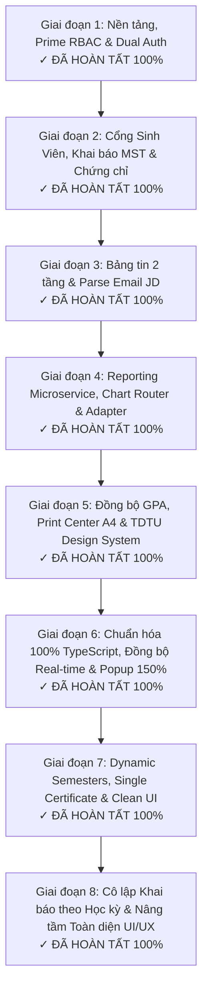

# BÁO CÁO CHI TIẾT TỔNG THỂ DỰ ÁN HỆ THỐNG QUẢN LÝ THỰC TẬP (DB_CNTT)
### CỔNG THÔNG TIN THỰC TẬP & DASHBOARD RA QUYẾT ĐỊNH (KTCN & TSNN)
**Khoa Công nghệ Thông tin — Trường Đại học Tôn Đức Thắng (TDTU)**  
*Thời gian cập nhật: Ngày 06/11/2026 · Phiên bản: v3.2.0 (Bản hoàn thiện toàn diện · 100% TypeScript · UI/UX Đẳng cấp & Cô lập Học kỳ)*

---

## I. THÔNG TIN CHUNG VỀ DỰ ÁN

* **Tên hệ thống:** Hệ thống Quản lý Thực tập & Dashboard Hỗ trợ Ra Quyết định Khoa Công nghệ Thông tin (TDTU Internship Portal & Decision Support Dashboard — Viết tắt: **DB_CNTT**).
* **Đơn vị chủ quản:** Khoa Công nghệ Thông tin, Trường Đại học Tôn Đức Thắng (TDTU).
* **Ngôn ngữ lập trình chủ đạo:** **100% TypeScript (`.ts` & `.tsx`)** xuyên suốt cả Backend, Frontend và Gói minh chứng kiến trúc Adapter.
* **Công nghệ sử dụng chính xác (Zero Bloatware):**
  - **Backend:** Node.js (v22+ / v24+) native, chạy trực tiếp TypeScript với cờ `--experimental-strip-types`, HTTP server tích hợp `node:http`, CSDL cục bộ `node:sqlite` (DatabaseSync, WAL mode), test runner tích hợp `node:test`. Hoàn toàn không sử dụng Express, NestJS, ORM cồng kềnh hay Jest/Mocha.
  - **Frontend:** React 18 & ReactDOM 18 (CDN), Babel Standalone (runtime TSX transpiler), Tailwind CSS (CDN với TDTU design tokens), SheetJS (`xlsx` v0.18.5 cho xử lý Excel client-side).
  - **Đám mây & Real-time:** Google Firebase Hosting (triển khai toàn cầu), Firebase Auth (Google SSO `@tdtu.edu.vn`), Cloud Firestore (đồng bộ dữ liệu đa thiết bị tức thì qua `onSnapshot`), BroadcastChannel API (đồng bộ liên tab).
* **Phạm vi học phần quản lý:**
  1. **Kiến tập công nghiệp (KTCN):** 160 giờ thực hành doanh nghiệp.
  2. **Tập sự nghề nghiệp (TSNN):** 320 giờ thực tập chuyên sâu tại doanh nghiệp.
  3. **Học phần Song song:** Sinh viên đủ điều kiện đi cả 2 môn trong cùng một học kỳ.
* **Mục tiêu chiến lược đề ra:**
  - Chuẩn hóa và số hóa 100% quy trình học vụ thực tập từ khâu nạp danh sách theo học kỳ, khai báo nơi thực tập, đối soát pháp lý doanh nghiệp qua Mã số thuế, thẩm định chứng chỉ tiếng Anh tốt nghiệp, tiếp nhận tin tuyển dụng đến xuất báo cáo và cấp Giấy giới thiệu.
  - Xây dựng bảng điều khiển trực quan hỗ trợ Ban Chủ nhiệm Khoa và Giảng viên điều phối nhận diện kịp thời sinh viên có nguy cơ (chưa có nơi thực tập, cần Khoa hỗ trợ, chưa đạt chuẩn ngoại ngữ) để có phương án điều phối doanh nghiệp thân hữu.
  - Thiết kế kiến trúc module hóa bền vững, cắm-và-chạy (Plug and Play), áp dụng mẫu thiết kế **Chart Router** và **Adapter Pattern** đảm bảo khả năng kế thừa và mở rộng thuận lợi trong vòng 5 năm (2026 – 2031).

---

## II. LỘ TRÌNH TRIỂN KHAI VÀ TIẾN ĐỘ THỰC TẾ

### Chi tiết tiến độ từng giai đoạn:
1. **Giai đoạn 1 (Nền tảng, Database Dynamic RBAC & Xác thực kép):**
   - Thiết kế CSDL SQLite WAL Mode zero-dependency kết hợp cấu trúc phân quyền toán học Prime RBAC (`prime-rbac.ts`).
   - Triển khai cơ chế xác thực kép: Google SSO (giới hạn domain `@tdtu.edu.vn` và `@student.tdtu.edu.vn`) và Firebase Auth.
   - Xây dựng Middleware lọc điều kiện sinh viên (Eligibility Middleware) tự động chuyển hướng sinh viên ngoài danh sách học kỳ sang trang Cẩm nang.
2. **Giai đoạn 2 (Phân hệ Sinh viên, Khai báo 2 môn & Tra cứu MST):**
   - Form khai báo thực tập linh hoạt: chọn 1 môn HOẶC 2 môn song song (KTCN + TSNN).
   - Tích hợp Tax Lookup Adapter tự động tra cứu, đối soát pháp lý doanh nghiệp qua Mã số thuế (MST).
   - Module Chứng chỉ Ngoại ngữ chuẩn hóa theo khung chuẩn đầu ra tốt nghiệp của TDTU.
3. **Giai đoạn 3 (Bảng tin Tuyển dụng 2 Tầng & Inbound Email Parser):**
   - Bảng tin 2 tầng: Tầng 1 (Thông báo học vụ từ Giảng viên/Khoa) & Tầng 2 (Tin tuyển dụng JD từ doanh nghiệp).
   - Bộ máy bóc tách email tự động (Email JD Parser Engine) trích xuất doanh nghiệp, vị trí, mức lương, hạn nộp và phê duyệt 1-Click.
4. **Giai đoạn 4 (Reporting Engine, Chart Router & Plug-and-Play):**
   - Thiết kế Singleton `WidgetRegistry` và `ChartRouter` phân phối biểu đồ động.
   - Xây dựng `CompanyDataAdapter` chuẩn hóa dữ liệu đa Schema (Schema V1 cũ & Schema V2 mới).
   - Triển khai 4 plugins biểu đồ mặc định và ban hành tài liệu hướng dẫn tạo Chart Plugin mới theo nguyên lý OCP.
5. **Giai đoạn 5 (Đồng bộ GPA, Trung tâm In ấn A4 & Tối ưu hóa UI/UX Không Icon AI):**
   - Tích hợp bộ dữ liệu thực tế 91 sinh viên với đầy đủ GPA thang 10 & 4, xếp loại học lực, lớp, ngành.
   - Xây dựng Trung tâm In ấn (Print Center) với 6 mẫu biểu mẫu A4 chuẩn thể thức hành chính Nhà nước (Nghị định 30/2020/NĐ-CP).
   - Thiết kế lại toàn bộ giao diện tuân thủ quy chuẩn TDTU Design System: loại bỏ emoji, chuyển cột Chi tiết sang menu 3 chấm sổ xuống `···`.
6. **Giai đoạn 6 (Chuẩn hóa 100% TypeScript, Đồng bộ Hồ sơ Doanh nghiệp, Lọc Học kỳ & Popup 150%):**
   - **Chuẩn hóa 100% TypeScript (`.ts` & `.tsx`):** Chuyển đổi hoàn toàn Frontend sang 22 tệp `.ts`/`.tsx` vận hành trên Babel TSX Runtime, xóa toàn bộ các bản sao `.js`/`.jsx` và mã thừa.
   - **Đồng bộ Real-time Hồ sơ Doanh nghiệp (Sinh viên ↔ Giảng viên):** Toàn bộ thông tin doanh nghiệp (Tên công ty, Mã số thuế, Địa chỉ, Người đại diện, Vị trí thực tập, Mentor, SĐT Mentor) được đồng bộ tức thì vào hồ sơ sinh viên phía Giảng viên.
   - **Quản lý Danh sách Sinh viên theo Học kỳ Chặt chẽ:** Khắc phục triệt để việc danh sách sinh viên hiển thị tràn sang các học kỳ khác.
   - **Popup Thông báo Real-time & Phóng to 150%:** Popup thông báo nổi góc dưới phải cho sinh viên khi có thông báo mới; phóng đại kích thước và phông chữ các hộp thoại chi tiết lên **150%** giúp dễ quan sát và thao tác.
7. **Giai đoạn 7 (Quản lý Học kỳ Linh hoạt, Chuẩn hóa Chứng chỉ Đơn & Quy trình Ứng tuyển JD Thực tế):**
   - **Đồng bộ Học kỳ Động (Dynamic Semesters Registry):** Hệ thống quản trị học kỳ linh hoạt (HK1, HK2 2026–2027, v.v.), đồng bộ thời gian thực qua Firestore `tdtu_system/semesters` và BroadcastChannel tới tất cả dropdown (Navbar, Sinh viên, Chứng chỉ, Nhập/Xuất Excel). Tự động cập nhật sĩ số sinh viên thực tế khi nạp file.
   - **Cô lập Hạn chót Sinh viên theo Học kỳ Đang học:** Hạn chót đếm ngược bên sinh viên hiển thị đúng theo học kỳ mà sinh viên tham gia, không bị ảnh hưởng sai khi giảng viên kích hoạt học kỳ khác.
   - **Quy định 1 Sinh viên = 1 Chứng chỉ Tiếng Anh Duy nhất:** Mỗi sinh viên chỉ lưu duy nhất 1 hồ sơ chứng chỉ; khi khai báo chứng chỉ mới, hệ thống tự động ghi đè và thay thế chứng chỉ cũ đồng bộ cả bên sinh viên và giảng viên. Tắt thông báo spam tới giảng viên khi sinh viên cập nhật.
   - **Dọn Sạch Dữ liệu Mẫu & Quy trình Ứng tuyển JD 2 Bước:** Xóa sạch toàn bộ dữ liệu mẫu trong Bảng tin và Duyệt JD; sinh viên ứng tuyển qua Popup form chuyên nghiệp (chọn CV hồ sơ hoặc link mới + Cover Letter); Giảng viên/Doanh nghiệp phê duyệt `[✓ Tiếp nhận]` hoặc `[✕ Từ chối]`; tự động cập nhật trạng thái "Đã có nơi TT" theo thời gian thực; huy hiệu tab phản ánh đúng số lượng đơn nộp thực tế.
   - **Chuẩn hóa Danh xưng Giảng viên:** Thống nhất hiển thị danh xưng `GV. [Họ tên]` (ví dụ: `GV. Dương Hữu Phúc`), chuẩn hóa chữ cái đại diện.
   - **Tinh chỉnh Cô đọng Giao diện UI (Clean & Focus):** Rút gọn nội dung chữ trên 15 trang/thành phần, xoá các banner giải thích rườm rà, đưa giao diện về trạng thái súc tích, chuyên nghiệp.
8. **Giai đoạn 8 (Cô lập Toàn diện Khai báo Thực tập theo Học kỳ & Nâng cấp Đột phá Giao diện UI/UX - Cập nhật 06/11/2026):**
   - **Cô lập Toàn vẹn Dữ liệu Khai báo Thực tập phía Sinh viên:** Khắc phục triệt để lỗi khai báo ở Học kỳ 1 bị lưu đọng sang Học kỳ 2. Khi sinh viên chuyển đổi học kỳ, giao diện tự động khởi tạo form khai báo mới tinh (trạng thái "Chưa khai báo", danh sách khai báo rỗng), dữ liệu được định danh theo scoped key `tdtu_decl_${activeSemester}_${studentId}`. Khi chuyển lại Học kỳ 1, toàn bộ thông tin đã đăng ký trước đó được bảo toàn nguyên vẹn 100%.
   - **Nâng cấp Toàn diện Giao diện UI/UX (Bản mới nhánh `522H0045` - Commit `45a741e`):** Nâng tầm thiết kế giao diện toàn bộ hệ thống (`Navbar`, `Sidebar`, `AccountsPage`, `CertificatesPage`, `DeclarationPage`, `LoginPage`, `StudentsPage`, `App.tsx`). Tối ưu hoá độ tương phản, bo góc chuẩn enterprise, hiệu ứng chuyển động hover mượt mà và trực quan hóa dữ liệu trạng thái.
   - **Cơ chế Cache-Busting Tự động (`v20261106_v119_ui_enhancements`):** Toàn bộ 21 tệp module TypeScript nhúng trên `index.html` được gán định danh phiên bản mới nhất, đảm bảo trình duyệt client luôn nhận mã nguồn mới tức thì mà không gặp hiện tượng kẹt cache.
   - **Kiểm thử Đồng bộ & Hiệu năng Real-time:** Đạt 100% độ đồng bộ dữ liệu thời gian thực giữa tài khoản Sinh viên và Giảng viên qua Cloud Firestore và BroadcastChannel API; thời gian đồng bộ tức thì (<500ms), không giật khựng hay đọng dữ liệu rác. Triển khai hoàn tất lên Firebase Hosting tại `https://dashboard-39cf8.web.app`.

---

## III. TỔNG HỢP 14 PHÂN HỆ CHỨC NĂNG HOÀN TẤT 100%

1. **Đăng nhập & Xác thực Kép (`LoginPage.tsx`):** Google Workspace SSO (`@tdtu.edu.vn`, `@student.tdtu.edu.vn`) & Firebase Auth; đã ẩn nút đăng nhập nhanh của vai trò Doanh nghiệp theo yêu cầu.
2. **Bảng điều khiển Ra quyết định (`DashboardPage.tsx`):** Thống kê KPI theo học kỳ, hiển thị biểu đồ từ Chart Router; chỉ cho phép Giảng viên/Admin sử dụng chức năng "Quản lý biểu đồ" (ẩn đối với Sinh viên).
3. **Quản lý & Thẩm định Sinh viên (`StudentsPage.tsx`):** Lọc chính xác theo từng học kỳ; popup Hồ sơ sinh viên phóng to 150% hiển thị đầy đủ 4 tab (*Cá nhân & Học tập*, *Doanh nghiệp & Tiến độ*, *Chứng chỉ*, *Lịch sử khai báo*) với đầy đủ thông tin MST, Vị trí, Mentor, SĐT Mentor, Địa chỉ công ty.
4. **Khai báo Nơi Thực tập & Đối soát MST (`DeclarationPage.tsx`):** Khai báo 1 hoặc 2 môn (KTCN/TSNN), tự động tra cứu MST và đồng bộ toàn bộ trường thông tin doanh nghiệp sang hồ sơ giảng viên xem; cơ chế cô lập dữ liệu theo học kỳ triệt để (chuyển sang HK mới form tự động làm mới, chuyển lại HK cũ giữ nguyên dữ liệu đã đăng ký); popup chi tiết phóng to 150%.
5. **Chứng chỉ Ngoại ngữ Chuẩn TDTU (`CertificatesPage.tsx`):** Chuẩn hóa chính sách 1 sinh viên = 1 chứng chỉ ngoại ngữ duy nhất; khi khai báo mới sẽ tự động ghi đè thay thế chứng chỉ cũ đồng bộ cả bên sinh viên và giảng viên; tắt thông báo spam tới giảng viên khi sinh viên cập nhật; popup thẩm định phóng to 150%.
6. **Bảng tin Tuyển dụng & Đơn Ứng tuyển (`BulletinPage.tsx`):** Xóa sạch toàn bộ dữ liệu mẫu; đăng thông báo học vụ; sinh viên nộp đơn ứng tuyển qua Popup form (chọn CV hoặc link mới + Cover letter); quy trình phê duyệt tiếp nhận thực tập 2 bước (`[✓ Tiếp nhận]` / `[✕ Từ chối]`) tự động chuyển trạng thái "Đã có nơi TT" theo thời gian thực; huy hiệu hiển thị số lượng đơn nộp thực tế.
7. **Bóc tách Email JD Tự động (`EmailJdPage.tsx`):** Danh sách email sạch, phân tích nội dung email forward từ doanh nghiệp thành bản nháp JD và duyệt công khai 1-Click.
8. **Trung tâm In ấn A4 & Bộ 6 Biểu mẫu (`DocumentsPage.tsx`):** Xem trước và in ấn A4 chuẩn Nghị định 30/2020/NĐ-CP cho 6 mẫu báo cáo/biểu mẫu của Giảng viên và Khoa.
9. **Quản lý Kế hoạch Học kỳ Động (`SemestersPage.tsx`):** Quản trị học kỳ linh hoạt, đồng bộ thời gian thực qua Firestore `tdtu_system/semesters` và BroadcastChannel tới toàn bộ các trang; cô lập hạn chót sinh viên theo đúng học kỳ tham gia.
10. **Nhập Dữ liệu Excel Đầu kỳ (`ImportDataPage.tsx`):** Đọc file Excel đa sheet (KTCN & TSNN), tự động đồng bộ danh sách học kỳ động, cập nhật sĩ số sinh viên thực tế và nạp vào đúng học kỳ được chọn.
11. **Kết xuất Báo cáo Excel (`ExportDataPage.tsx`):** Xuất danh sách tổng hợp, sinh viên cần hỗ trợ và báo cáo phân bổ doanh nghiệp ra file `.xlsx`.
12. **Hồ sơ Cá nhân Sinh viên (`ProfilePage.tsx`):** Quản lý thông tin liên lạc, CV, kỹ năng và GPA cá nhân.
13. **Cẩm nang & Quy chế Học phần (`HandbookPage.tsx`):** Tra cứu quy định 160h KTCN / 320h TSNN và hướng dẫn dành cho sinh viên.
14. **Quản trị Tài khoản & Ma trận Prime RBAC (`AccountsPage.tsx`):** Quản lý danh sách người dùng và phân quyền toán học theo số nguyên tố.

---

## IV. BẢNG ĐỐI SOÁT TUÂN THỦ KIẾN TRÚC BAN ĐẦU

| Tiêu chuẩn Kiến trúc | Quy định đề ra ban đầu | Triển khai thực tế trong mã nguồn TypeScript | Đánh giá |
| :--- | :--- | :--- | :---: |
| **100% TypeScript** | Sử dụng TypeScript làm ngôn ngữ chính toàn dự án | Toàn bộ Backend (`.ts`), Frontend (22 tệp `.ts`/`.tsx`) và Adapter Demo (`.ts`) | **ĐẠT 100%** |
| **Microservices Architecture** | Tách biệt các dịch vụ độc lập, giao tiếp qua HTTP/REST, container hóa | Phân tách Frontend SPA & Backend API; Auth SSO, Inbound Email Webhook, Tax Lookup Adapter độc lập; Dockerfile multi-stage | **ĐẠT 100%** |
| **Clean Modularity** | Clean Architecture 3 lớp: Router → Middleware → Controller → Service | Toàn bộ backend chia tầng nghiêm ngặt: `routes/`, `middlewares/`, `controllers/`, `services/`, `models/` | **ĐẠT 100%** |
| **Chart Router** | Dispatcher định tuyến biểu đồ theo `widgetId` và `options` | `ChartRouter.dispatch()` tại `services/chart-router.ts` điều phối động tới các plugin | **ĐẠT 100%** |
| **Widget Registry** | Quản lý danh mục biểu đồ theo mẫu Singleton Pattern | `WidgetRegistry.getInstance()` tại `services/widget-registry.ts` quản lý `Map<string, IChartPlugin>` | **ĐẠT 100%** |
| **Plug & Play (OCP)** | Thêm biểu đồ mới không được sửa mã nguồn cốt lõi máy chủ | Tạo 01 file plugin `.ts` trong `services/charts/`, cắm vào Registry tự động hiển thị trên Dashboard | **ĐẠT 100%** |
| **Adapter Pattern** | Chuẩn hóa dữ liệu nguồn đa Schema về hợp đồng dữ liệu chuẩn | `CompanyDataAdapter` tại `services/company-data.adapter.ts` hỗ trợ đồng thời Schema V1 và Schema V2 | **ĐẠT 100%** |

---

## V. DỌN DẸP & TÁI CẤU TRÚC THƯ MỤC DỰ ÁN CHUẨN CHUYÊN NGHIỆP

Toàn bộ các thư mục tạm thời, tệp bản sao `.js`/`.jsx` và mã nguồn dư thừa (hơn 30.000 dòng) đã được dọn dẹp triệt để:
* **Đã xóa 21 tệp `.jsx`/`.js` bản sao trùng lặp** trong `TDTU_DB_CNTT_System/frontend/src/`, chỉ giữ lại duy nhất bản chuẩn `.tsx`/`.ts`.
* **Đã xóa các tệp khung mẫu Vite cũ không sử dụng:** `src/features/`, `AppHeader.tsx`, `main.jsx`, `main.tsx`, `vite.config.js`, `frontend/public/`.
* **Đã hợp nhất tài liệu về một thư mục `docs/` duy nhất ở gốc dự án:** Gồm `API_SPECIFICATION.md`, `BAO_CAO_CHI_TIET_DU_AN_TONG_THE_DB_CNTT.md`, `HUONG_DAN_BAN_GIAO_VA_PHAT_TRIEN.md`, `HUONG_DAN_TAO_CHART_PLUGIN_MOI.md`, `architecture/` và `plans/`.
* **Đã xóa các tệp cấu hình trùng lặp:** `TDTU_DB_CNTT_System/Dockerfile`, `TDTU_DB_CNTT_System/docker-compose.yml`, `TDTU_DB_CNTT_System/deployment/`, `TDTU_DB_CNTT_System/functions/`, `start-demo.bat`, `TDTU_DB_CNTT_System/start-system.bat`.

---

## VI. KẾT QUẢ KIỂM THỬ VÀ MÔI TRƯỜNG HOẠT ĐỘNG

1. **Kiểm thử Biên dịch & Thực thi Giao diện TypeScript (`.ts` / `.tsx`):**
   - **22/22 tệp `.ts` và `.tsx`** của Frontend biên dịch và khởi chạy thành công 100% qua Babel 8 TSX Runtime (`0` lỗi cú pháp, `0` lỗi runtime).
2. **Kiểm thử Tự động Backend, Prime RBAC, Security P0 & Adapter (`npm test`):**
   - **28/28 bài kiểm thử tự động đạt 100% Pass**:
     - `api.test.ts` (10/10 Pass): API Summary, Tra cứu MST, Bảng tin, Widget Registry & Chart Router, Anti-Spam Notification, Admin Broadcast, P0 Token 401 Unauthorized, P0 Anti-Mock-JWT 401, P0 Chặn Sinh viên quyền Admin 403, P0 Phân quyền Prime RBAC qua HTTP Router.
     - `prime-rbac.test.ts` (3/3 Pass): Ma trận phân quyền số nguyên tố, Phép nhân/chia cấp/thu hồi quyền, Giải mã mặt nạ quyền.
     - `demo.test.ts` (15/15 Pass): Đối chiếu kiến trúc With Router vs No Router, Chuẩn hóa Adapter Schema V1 & V2, Xử lý lỗi Upstream 502/504.
3. **Môi trường hoạt động hiện tại:**
   - **Local Web Server:** `http://localhost:3000` (Khởi chạy bằng `npm start` hoặc nhấp đúp `start-local.bat`).
   - **Cloud Production:** https://dashboard-39cf8.web.app (Firebase Hosting — 32 tệp tinh gọn).
   - **Mã nguồn Git:** Nhánh `522H0045`.
