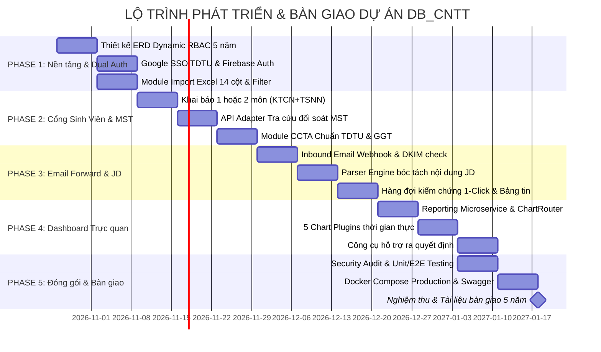

# 📋 KẾ HOẠCH THIẾT KẾ VÀ PHÁT TRIỂN CHI TIẾT HỆ THỐNG QUẢN LÝ THỰC TẬP (DB_CNTT)
### KHOA CÔNG NGHỆ THÔNG TIN — TRƯỜNG ĐẠI HỌC TÔN ĐỨC THẮNG (TDTU)
**Hệ thống Quản lý Thực tập, Tự động hóa JD & Trực quan hóa Dữ liệu Hỗ trợ Ra quyết định (Decision Support Dashboard)**  
*Định hướng thiết kế bền vững, kế thừa và mở rộng trong 5 năm · Công nghệ: Node.js + React (TypeScript)*

---

## PHẦN 1: TỔNG QUAN KIẾN TRÚC & GIẢI PHÁP KỸ THUẬT TRỌNG TÂM

### 1.1. Cơ chế Xác thực Kép (Dual Authentication) & Kiểm soát Truy cập
Hệ thống triển khai cơ chế xác thực kép chuẩn bảo mật cao cấp dành cho môi trường học thuật và doanh nghiệp:
* **Kênh 1 — Google SSO (Domain Restriction):** Sử dụng Google OAuth 2.0 giới hạn nghiêm ngặt các domain email chính thức do Trường ĐH Tôn Đức Thắng cấp phát:
  * `@student.tdtu.edu.vn`: Dành cho Sinh viên, tự động bóc tách MSSV từ tiền tố email để liên kết trực tiếp với hồ sơ sinh viên trong CSDL.
  * `@tdtu.edu.vn`: Dành cho Giảng viên và Ban chủ nhiệm Khoa.
  * Từ chối toàn bộ các email cá nhân ngoài trường (`@gmail.com`, `@yahoo.com`...) với mã lỗi bảo mật `403 Forbidden`.
* **Kênh 2 — Firebase Auth (Tài khoản nội bộ):** Quản lý người dùng, mật khẩu, phiên làm việc an toàn qua Firebase Authentication. Hỗ trợ đồng bộ `firebaseUid`, kiểm tra trạng thái kích hoạt tài khoản (`isActive`), phát hiện khóa tài khoản và khôi phục linh hoạt.
* **Điều kiện kích hoạt quyền Sinh viên (Eligibility Middleware):** 
  * Chỉ những sinh viên có tên trong danh sách đăng ký môn Kiến tập công nghiệp (KTCN) hoặc Tập sự nghề nghiệp (TSNN) trong học kỳ hiện tại (được import từ file Excel/CSV đầu kỳ) mới có quyền truy cập vào các màn hình chức năng khai báo thực tập và nộp chứng chỉ.
  * Các sinh viên thuộc Khoa nhưng không đăng ký môn học trong kỳ sẽ tự động được hệ thống chuyển hướng sang trang Cẩm nang thông tin và quy chế thực tập.

### 1.2. Mô hình Phân quyền Mở rộng (Dynamic RBAC — 5 Năm Mở Rộng)
* **Phân quyền chung cho Giảng viên (Shared Lecturer Role):** Toàn bộ Giảng viên phụ trách trong Khoa đều có chung quyền quản trị dữ liệu, import danh sách sinh viên, duyệt/xuất Giấy giới thiệu và xem toàn bộ dữ liệu báo cáo thống kê phục vụ công tác điều hành chung.
* **Tính minh bạch & Đồng nhất nội dung:** Toàn bộ nội dung thống kê tiến độ, mạng lưới doanh nghiệp đối tác, bảng tin JD tuyển dụng đều được hiển thị đồng nhất cho cả Giảng viên và Sinh viên (chỉ ẩn các nút công cụ quản trị, chỉnh sửa đối với Sinh viên).
* **Dự phòng Role mở rộng:** Cơ sở dữ liệu được thiết kế chuẩn Dynamic RBAC với các bảng: `users`, `roles`, `permissions`, `role_permissions`. Sẵn sàng tích hợp thêm các vai trò mới trong tương lai như **Doanh nghiệp tuyển dụng**, **Giáo vụ khoa**, **Ban chủ nhiệm** mà không cần tái cấu trúc lại hệ thống.

### 1.3. Luồng Tự Động Hóa Tiếp Nhận JD Qua Email (Email Forwarding Service Flow)
Khi doanh nghiệp đối tác gửi email tuyển dụng cho Giảng viên, Thầy/Cô chỉ cần chuyển tiếp (Forward) email đến địa chỉ tiếp nhận chuyên dụng của hệ thống (ví dụ: `jd-intake@cntt-internship.tdtu.edu.vn`):
1. **Tiếp nhận Webhook:** Inbound Email Service (SendGrid/Mailgun/Cloudflare hoặc Webhook Node.js nội bộ) tiếp nhận payload email và đẩy vào API hệ thống.
2. **Kiểm chứng chính xác & Bảo mật:** Kiểm tra chữ ký số DKIM/SPF, xác thực địa chỉ email người forward nằm trong danh sách Giảng viên hợp lệ (`@tdtu.edu.vn`); lưu trữ file đính kèm an toàn.
3. **Bóc tách nội dung (JD Parser Engine):** Tự động trích xuất Tên công ty, Mã số thuế (MST 10–13 số), Vị trí tuyển dụng, Quyền lợi/Trợ cấp, Hạn nộp hồ sơ, Kỹ năng yêu cầu, và đưa vào trạng thái **'Chờ duyệt' (Pending)**.
4. **Phê duyệt 1-Click:** Giảng viên rà soát nhanh bản bóc tách trên Dashboard và chỉ cần nhấn nút **"✓ Phê Duyệt & Công Khai"** để đưa JD lên Bảng tin thực tập cho Sinh viên ứng tuyển trực tiếp.

### 1.4. Định dạng Dữ liệu Đầu vào & Vai trò Database Hỗ trợ Ra Quyết định
* **Định dạng đầu vào chuẩn:** 100% dữ liệu danh sách sinh viên đăng ký môn học, danh sách công ty đầu kỳ được nạp qua file Excel (`.xlsx`, `.csv`) gồm 14 cột chuẩn của Khoa (áp dụng chuẩn xác trên bộ dữ liệu thực tế HK1/2026-2027 gồm **91 sinh viên duy nhất, 134 lượt đăng ký môn, 43 sinh viên đi cả 2 môn**).
* **Database hỗ trợ ra quyết định (Decision Support):** CSDL SQLite/PostgreSQL được đánh chỉ mục và thiết kế tối ưu cho các truy vấn tổng hợp số liệu thời gian thực lên Dashboard, giúp Giảng viên nhận diện ngay sinh viên chưa có nơi thực tập hoặc sinh viên chọn *"Cần Khoa hỗ trợ"* để kịp thời điều phối vào các doanh nghiệp thân hữu.

---

## PHẦN 2: BẢNG PHÂN QUYỀN CHỨC NĂNG CHI TIẾT (FUNCTIONAL MATRIX)

| Mã CN | Nhóm Chức Năng | Chi Tiết Nghiệp Vụ Cập Nhật | Sinh Viên (SV) | Giảng Viên (GV) | Role Dự Phòng (Tương Lai) |
| :---: | :--- | :--- | :---: | :---: | :--- |
| **AUTH-01** | Xác thực & Phân quyền | Đăng nhập bằng Google SSO giới hạn domain `@tdtu.edu.vn` và `@student.tdtu.edu.vn` | Có | Có | Cấu hình theo domain |
| **AUTH-02** | Xác thực & Phân quyền | Đăng nhập và quản lý tài khoản qua Firebase Auth (đồng bộ UID, token, khóa/mở khóa) | Có | Có | Cấu hình theo cấp phát |
| **AUTH-03** | Xác thực & Phân quyền | Kiểm tra điều kiện sinh viên có tên trong danh sách môn KTCN/TSNN kỳ hiện tại | Chặn nếu ngoài kỳ | Toàn quyền truy cập | Tùy chỉnh permission |
| **DATA-01** | Dữ liệu Đầu vào | Import danh sách sinh viên đủ điều kiện bằng file Excel/CSV chuẩn (14 cột) | Không | Có (Toàn quyền) | Cấp cho Giáo vụ khoa |
| **DATA-02** | Dữ liệu Đầu vào | Tải lên biểu mẫu, quy chế, tài liệu hướng dẫn thực tập | Xem & Tải về | Tải lên / Sửa / Xóa | Cấp cho Giáo vụ khoa |
| **DASH-01** | Dashboard Trực quan | Bộ lọc toàn cục theo Học kỳ & Đồng hồ đếm ngược Deadline nộp doanh nghiệp | Có | Có | Có |
| **DASH-02** | Dashboard Trực quan | Xem biểu đồ tổng quan (Tiến độ thực tập, Nguồn thân hữu/mới, Lĩnh vực, CCTA) | Xem số liệu chung | Xem & Phân tích ra QĐ | Có |
| **DASH-03** | Dashboard Trực quan | Xem bảng danh sách chi tiết sinh viên, lọc theo môn học, 2 môn & trạng thái | Xem danh sách chung | Xem hồ sơ & minh chứng | Theo phân quyền |
| **JD-01** | Cổng JD Tuyển dụng | Tiếp nhận Email Forward từ GV $\rightarrow$ Tự động bóc tách tạo bản nháp JD | Không | Gửi forward & Duyệt | Doanh nghiệp tự đăng |
| **JD-02** | Cổng JD Tuyển dụng | Đăng tải thủ công, chỉnh sửa, ẩn/hiện tin tuyển dụng của công ty đối tác | Không | Có | Doanh nghiệp tự quản lý |
| **JD-03** | Cổng JD Tuyển dụng | Xem danh sách JD công ty thầy cô giới thiệu, lọc vị trí & ứng tuyển 1-Click | Có (Xem & Ứng tuyển) | Có (Giám sát ứng tuyển) | Xem tin nội bộ |
| **INT-01** | Khai báo Thực tập | Chọn 1 môn HOẶC 2 môn cùng lúc (KTCN + TSNN) & Tra cứu đối soát Mã Số Thuế | Có (Khai báo) | Xem thông tin | Không |
| **INT-02** | Khai báo & Giấy GT | Yêu cầu cấp Giấy giới thiệu (GGT) thực tập & Theo dõi Badge tiến trình | Có (Gửi yêu cầu) | Quản lý & Duyệt | Hỗ trợ in ấn |
| **INT-03** | Khai báo & Giấy GT | Công cụ tự động sinh bản in Giấy giới thiệu, tải đơn lẻ hoặc hàng loạt | Không | Có (Tải bản in/ký) | Giáo vụ in ấn |
| **INT-04** | Khai báo Thực tập | Cập nhật trạng thái: Có DN / Chờ phỏng vấn / Tự tìm / Cần Khoa hỗ trợ | Có (Cập nhật) | Theo dõi & Điều phối | Không |
| **CERT-01** | Quản lý Chứng chỉ | Khai báo chứng chỉ ngoại ngữ chuẩn tốt nghiệp TDTU (TOEIC, IELTS, VSTEP, Cam kết) | Thêm / Sửa / Xóa | Thẩm định minh chứng | Không |
| **SYS-01** | Quản trị Hệ thống | Quản lý danh mục học kỳ, phân quyền tài khoản Firebase và cấu hình mở rộng 5 năm | Không | Có (Toàn quyền GV) | Admin cấp cao |

---

## PHẦN 3: KẾ HOẠCH TRIỂN KHAI & TIẾN ĐỘ THEO GIAI ĐOẠN

### Chi tiết mục tiêu từng Phase:
* **PHASE 1 — Khởi tạo Kiến trúc, Database Mở rộng & Hệ thống Xác thực Kép (Tuần 1 – Tuần 2):**
  * Thiết kế Database tối ưu cho phân quyền động: `users`, `roles`, `permissions`, `role_permissions`, `semesters`, `student_enrollments`.
  * Tích hợp xác thực kép: Google SSO (domain `@tdtu.edu.vn` và `@student.tdtu.edu.vn`) & Firebase Auth (đồng bộ UID, token).
  * Module Import Excel: Xây dựng bộ đọc file Excel danh sách sinh viên theo mẫu 14 cột của Khoa.
  * Middleware kiểm tra điều kiện sinh viên: Phân luồng sinh viên trong danh sách kỳ hiện tại và điều hướng sinh viên ngoài danh sách sang Cẩm nang thông tin.
* **PHASE 2 — Phân hệ Sinh viên – Khai báo Thực tập, Chứng chỉ & Tự động hóa GGT (Tuần 3 – Tuần 5):**
  * Giao diện khai báo thực tập: Lựa chọn 1 môn HOẶC cả 2 môn cùng lúc (KTCN + TSNN), tích hợp API tra cứu MST tự động hiển thị bảng đối soát pháp lý doanh nghiệp.
  * Cập nhật trạng thái thực tập: Đồng bộ tức thì sang Dashboard khi sinh viên đổi trạng thái (Có DN / Chờ PV / Tự tìm / Cần hỗ trợ).
  * Module Chứng chỉ Ngoại ngữ: Chuẩn hóa nghiêm ngặt theo chuẩn đầu ra TDTU (TOEIC, IELTS, TOEFL iBT, Cambridge, VSTEP, Aptis ESOL, Ngoại ngữ 2 và Giấy cam kết).
  * Quy trình Giấy giới thiệu (GGT): Sinh viên gửi yêu cầu cấp GGT, Giảng viên phê duyệt và xuất bản in PDF tự động.
* **PHASE 3 — Hệ thống JD Doanh nghiệp Giới thiệu & Luồng Email Forward (Tuần 6 – Tuần 8):**
  * Inbound Email Webhook: Tiếp nhận email chuyển tiếp từ Thầy/Cô, kiểm tra chữ ký số DKIM/SPF và whitelist email Giảng viên.
  * JD Parser Engine: Tự động trích xuất Tên công ty, MST, vị trí, quyền lợi/trợ cấp, hạn nộp và đưa vào hàng đợi kiểm chứng.
  * Hàng đợi kiểm chứng 1-Click: Giảng viên rà soát bản bóc tách và bấm duyệt để công khai lên Bảng tin cho sinh viên ứng tuyển.
  * Bảng tin 2 tầng phân cấp: Tầng trên là Thông báo của Giảng viên & Khoa, Tầng dưới là Tin tuyển dụng JD.
* **PHASE 4 — Dashboard Trực quan hóa Dữ liệu & Hỗ trợ Ra quyết định (Tuần 9 – Tuần 10):**
  * Cụm 5 thẻ thống kê (Metric Cards) và hệ thống biểu đồ thông minh qua kiến trúc **WidgetRegistry** và **ChartRouter**.
  * Bảng danh sách chi tiết 91 sinh viên với bộ lọc tìm nhanh sinh viên *"Cần Khoa hỗ trợ"* để Giảng viên kịp thời giới thiệu vào doanh nghiệp đối tác thân hữu.
* **PHASE 5 — Kiểm thử Bảo mật, Tối ưu Hiệu năng & Đóng gói Vận hành 5 Năm (Tuần 11 – Tuần 12):**
  * Kiểm thử bảo mật (Security Audit): Chống giả mạo JWT, kiểm tra phân quyền API, kiểm tra an toàn dữ liệu upload.
  * Tối ưu truy vấn & Caching: Index hóa theo học kỳ, tối ưu hóa CSDL đảm bảo tốc độ khi dữ liệu tích lũy 5–10 năm.
  * Đóng gói Docker Compose triển khai chuẩn hóa, tài liệu kỹ thuật OpenAPI/Swagger và bộ tài liệu hướng dẫn mở rộng cho người kế thừa.

---

## PHẦN 4: ĐỊNH HƯỚNG BẢO TRÌ & MỞ RỘNG TRONG 5 NĂM TỚI

1. **Kiến trúc Module hóa (Modular Microservice Architecture):** Tách biệt rõ ràng các phân hệ `Auth`, `Excel-Importer`, `Internship-Core`, `Email-JD-Service` và `Reporting-Engine`. Khi có yêu cầu thay đổi mẫu Giấy giới thiệu hoặc cấu trúc file Excel đầu vào, chỉ cần cấu hình lại module tương ứng mà không làm xáo trộn mã nguồn lõi.
2. **Cấu hình tập trung (Configuration over Hard-coding):** Toàn bộ danh mục chứng chỉ ngoại ngữ, mốc thời hạn học kỳ, tiêu chí bóc tách email và ánh xạ cột file Excel đều được quản lý tập trung, giúp Giảng viên quản trị dễ dàng cập nhật theo quy chế mới của Nhà trường.
3. **Đóng gói bằng Docker (Containerization):** Toàn bộ Backend Node.js, Frontend React, CSDL SQLite/PostgreSQL và Redis được đóng gói trong `docker-compose.yml`. Việc chuyển giao cho các thế hệ sinh viên/giảng viên kế tiếp chỉ mất đúng **1 lệnh chạy duy nhất** (`docker compose up --build`).
4. **Tài liệu hóa chuẩn OpenAPI (Swagger):** 100% API đều có tài liệu OpenAPI/Swagger tự động sinh, hỗ trợ kiểm thử trực tiếp và giúp lập trình viên mới nắm bắt kiến trúc hệ thống nhanh chóng.

---

## PHẦN 5: MA TRẬN PHÂN CÔNG TRÁCH NHIỆM & WBS (NHÓM 5 THÀNH VIÊN)

| Thành Viên & Vai Trò | Trách Nhiệm Trọng Tâm | Hạng Mục Phụ Trách Chính (WBS) |
| :--- | :--- | :--- |
| **M1 — Trưởng nhóm / Full-Stack Architect** | Kiến trúc Monorepo, Bảo mật & Reporting Engine | Kiến trúc Monorepo, Google SSO & Firebase Auth, Core Reporting Microservice & Chart Router, Docker Compose |
| **M2 — Backend Lead (Database & Data Adapter)** | CSDL, RESTful API & Adapter tra cứu MST | Prisma Schema, SQLite/PostgreSQL, Adapter tra cứu MST (xinvoice), Service Import Excel 14 cột, Service Sinh viên |
| **M3 — Frontend Lead (React, State & Forms)** | Cổng Sinh viên & Form Khai báo 2 môn | React 19 UI, Form chọn 1 hoặc 2 môn (KTCN+TSNN), Bảng đối soát MST đọc nộp lại, Quản lý chứng chỉ ngoại ngữ TDTU |
| **M4 — UI/UX Visualizer & Data Analytics** | Thiết kế Giao diện, Dashboard & Bảng tin 2 tầng | Trang Đăng Nhập, Bảng tin Tầng 1 (Tin GV) & Tầng 2 (JD), Dashboard Recharts trực quan hóa, Bộ lọc dữ liệu 91 sinh viên |
| **M5 — DevOps, QA/QC Tester & Technical Writer** | Inbound Email Parser, Kiểm thử tự động & Tài liệu | Engine bóc tách Email Forward JD, Bộ kiểm thử tự động (17 Test Suites), CI/CD GitHub Actions, Bộ tài liệu hướng dẫn 5 năm |
